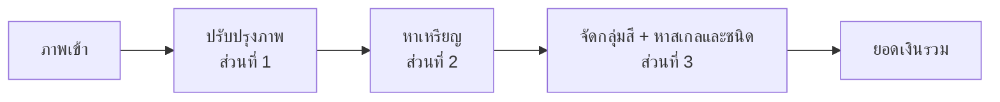

# baht-counter

เว็บแอปนับเหรียญและคำนวณยอดเงินไทยจากภาพถ่าย โครงงานวิชาการประมวลผลภาพและเสียง (ทีม 5 คน, 5 สัปดาห์)

ผู้ใช้ถ่ายหรืออัปโหลดภาพเหรียญที่วางบนพื้นราบ ระบบหาเหรียญทุกเหรียญ บอกชนิด และรวมยอดเงิน ถ้าระบบอ่านผิด ผู้ใช้แก้บนหน้าเว็บได้

แผนงานฉบับเต็มอยู่ที่ [`docs/plan.md`](docs/plan.md)

---

## ระบบทำอะไร

รองรับเหรียญไทยที่ใช้อยู่ปัจจุบัน 6 ชนิด

| ชนิด | รหัส | เส้นผ่านศูนย์กลาง (มม.) | กลุ่มสี |
|---|---|---|---|
| 25 สตางค์ | `THB_0_25` | 16 | copper |
| 50 สตางค์ | `THB_0_50` | 18 | copper |
| 1 บาท | `THB_1` | 20 | silver |
| 2 บาท | `THB_2` | 21.75 | gold |
| 5 บาท | `THB_5` | 24 | silver |
| 10 บาท | `THB_10` | 26 | bimetal |

**แนวคิดหลัก:** ภาพจากเว็บไม่มีไม้บรรทัด ระบบจึงใช้**สีแบ่งกลุ่มก่อน แล้วใช้ขนาดเทียบกันเอง** เพื่อหาสเกล (มม./พิกเซล) ที่ทำให้ทุกเหรียญตรงกับชนิดที่เป็นไปได้มากที่สุด ถ้าสเกลไม่ชัด ระบบตอบ `needs_confirmation` แล้วให้ผู้ใช้เลือกชนิดเหรียญ 1 เหรียญเป็นตัวอ้างอิง



## เทคโนโลยี

| ชั้น | เทคโนโลยี |
|---|---|
| Frontend | React + Vite + TypeScript, Tailwind CSS |
| Backend | Python 3.11 + FastAPI + Pydantic |
| ประมวลผลภาพ | OpenCV, NumPy, scikit-image (CNN เปรียบเทียบด้วย PyTorch) |
| ฐานข้อมูล | SQLite |
| Deploy | Render free tier: Web Service เดียวจาก `Dockerfile` (backend เสิร์ฟหน้าเว็บด้วย) https://baht-counter.onrender.com / ในเครื่องใช้ Docker Compose |

## โครงสร้างโปรเจกต์

```text
baht-counter/
├── frontend/                 # ส่วนที่ 5
├── backend/
│   ├── app/                  # ส่วนที่ 4: FastAPI, routes, DB
│   │   └── pipeline.py       # เรียกโมดูลตามลำดับ
│   ├── modules/
│   │   ├── preprocess/       # ส่วนที่ 1
│   │   ├── detection/        # ส่วนที่ 2
│   │   └── classification/   # ส่วนที่ 3
│   ├── schemas/              # Pydantic schema กลาง (แก้ต้องผ่าน PR ที่ทุกคนเห็น)
│   └── tests/
├── data/
│   ├── samples/              # 5–10 ภาพตัวอย่างที่ทุกคนรันได้ (เก็บใน git)
│   ├── raw/                  # ภาพทั้งหมด (ไม่เก็บใน git)
│   ├── labels/               # ป้ายกำกับ JSON
│   └── splits.csv
├── eval/                     # สคริปต์ประเมินผล
├── docs/
└── docker-compose.yml
```

## การแบ่งงาน

| ส่วน | งาน | ผู้รับผิดชอบ | Issue | Branch |
|---|---|---|---|---|
| 1 | ชุดข้อมูล การปรับปรุงภาพ และการตรวจคุณภาพภาพ | [@Peem-Atikorn](https://github.com/Peem-Atikorn) | [#1](https://github.com/Peem-Atikorn/baht-counter/issues/1) | `p1/Name` |
| 2 | หาตำแหน่งเหรียญ | [@titleww](https://github.com/titleww) | [#2](https://github.com/Peem-Atikorn/baht-counter/issues/2) | `p2/Name` |
| 3 | จำแนกชนิดเหรียญ หาสเกล และการประเมินผลรวม | [@wissarut-29](https://github.com/wissarut-29) | [#3](https://github.com/Peem-Atikorn/baht-counter/issues/3) | `p3/Name` |
| 4 | Backend API ฐานข้อมูล และ Deploy | [@fffalafair](https://github.com/fffalafair) | [#4](https://github.com/Peem-Atikorn/baht-counter/issues/4) | `p4/Name` |
| 5 | Frontend เว็บแอป | [@Notnrxth](https://github.com/Notnrxth) | [#5](https://github.com/Peem-Atikorn/baht-counter/issues/5) | `p5/Name` |

`Name` คือชื่อของผู้รับผิดชอบส่วนนั้น

## การทำงานร่วมกัน

### Branch

```text
pX/Name  ──PR──▶  develop  ──PR (1 approve)──▶  main
```

| Branch | ใช้ทำอะไร | กฎ |
|---|---|---|
| `main` | เวอร์ชันที่ deploy และส่งอาจารย์ | รับเฉพาะ PR จาก `develop`, ต้องมี 1 คน approve |
| `develop` | รวมงานทุกส่วน (default branch) | ต้องเปิด PR, merge เองได้ |
| `pX/Name` | งานของส่วนที่ X | สร้างจาก `develop` |
| `docs/<ชื่องาน>` | เอกสารหรือของที่ใช้ร่วมกันทุกส่วน | สร้างจาก `develop` |

**ตั้งชื่อ branch**
- ขึ้นต้นด้วยเลขส่วนของตัวเอง `p1/` ถึง `p5/` แล้วตามด้วยชื่อตัวเอง เช่น `p2/Name`
- ใช้ภาษาอังกฤษ ไม่มีเว้นวรรค

### เริ่มต้นสำหรับสมาชิก (ทำครั้งแรกครั้งเดียว)

ตัวอย่างด้านล่างใช้ส่วนที่ 2 ให้เปลี่ยน `p2` และ `#2` เป็นเลขส่วนของตัวเอง และเปลี่ยน `Name` เป็นชื่อตัวเอง

**1. รับคำเชิญเข้า repo**
เปิด https://github.com/Peem-Atikorn/baht-counter/invitations แล้วกด **Accept invitation** (หรือกดจากอีเมลที่ GitHub ส่งมา)

**2. ดูงานของตัวเอง**
เปิด issue ของส่วนตัวเองจากตาราง [การแบ่งงาน](#การแบ่งงาน) (ผู้รับผิดชอบถูก Assign ไว้แล้ว)

**3. โหลดโปรเจกต์ลงเครื่อง**

```bash
git clone https://github.com/Peem-Atikorn/baht-counter.git
cd baht-counter
```

**4. สร้าง branch ของตัวเองจาก `develop` แล้วส่งขึ้น GitHub**

```bash
git switch develop
git switch -c p2/Name
git push -u origin p2/Name
```

### ทำงานประจำวัน

**1. ดึงงานล่าสุดของเพื่อนมาก่อนเริ่มทำงานทุกครั้ง**

```bash
git switch develop
git pull
git switch p2/Name
git merge develop
```

**2. แก้โค้ดแล้ว commit + push**

```bash
git add .
git commit -m "p2: เพิ่ม watershed แยกเหรียญที่ชิดกัน"
git push
```

**3. เปิด PR เข้า `develop`** เมื่องานชิ้นหนึ่งเสร็จและรันได้
- บน GitHub กด **Compare & pull request** (หรือแท็บ Pull requests → New pull request)
- ตรวจว่า base เป็น `develop` และ compare เป็น `p2/Name`
- ในคำอธิบาย PR เขียน `Refs #2` สำหรับงานย่อยระหว่างทาง หรือ `Closes #2` เมื่องานของส่วนนั้นเสร็จทั้งหมด
- กด **Merge pull request** ได้เลย ไม่ต้องรอคน approve (ถ้าอยากให้เพื่อนช่วยดู ให้เพิ่มชื่อใน Reviewers)

**4. ทำงานต่อบน branch เดิม** กลับไปทำข้อ 1 ใหม่

> push ตรงเข้า `develop` หรือ `main` ไม่ได้ ต้องผ่าน PR เสมอ ถ้า push แล้วขึ้น `protected branch` แปลว่าลืมสลับมา branch ของตัวเอง

### ใช้ AI ช่วยเขียนโค้ด

repo มี [`AGENTS.md`](AGENTS.md) บอก AI เรื่องโปรเจกต์ โฟลเดอร์ของแต่ละส่วน กติกาโค้ด และวิธีเปิด PR ไว้แล้ว ให้ AI อ่านไฟล์นี้ก่อนเริ่มงานทุกครั้ง

ทำข้อ 1–3 ของ "เริ่มต้นสำหรับสมาชิก" ให้เสร็จก่อน แล้วเปิด AI ในโฟลเดอร์ `baht-counter` และพิมพ์ เช่น

```text
อ่าน AGENTS.md ก่อน ผมทำส่วนที่ 2 ชื่อ Name ช่วยสร้าง branch p2/Name จาก develop
แล้วอ่าน issue #2 กับ docs/plan.md สรุปงานที่ต้องทำ และเริ่มงานแรกให้หน่อย
```

### การแจ้งเตือน

- **ทุกคน:** กดปุ่ม **Watch** มุมขวาบนของ repo → **All Activity** (ได้แจ้งเตือนทุกเรื่อง) หรือ **Custom → Pull requests, Issues**
- **อัตโนมัติ:** [`.github/CODEOWNERS`](.github/CODEOWNERS) บอกว่าแต่ละโฟลเดอร์เป็นของใคร เมื่อมี PR แก้ไฟล์ในโฟลเดอร์นั้น GitHub จะขอ review จากเจ้าของโฟลเดอร์และหัวทีมให้เอง แบ่งงานแล้วให้ใส่ชื่อ GitHub ของผู้รับผิดชอบในไฟล์นี้
- อยากเรียกใครโดยตรง ให้พิมพ์ `@ชื่อ` ใน comment หรือคำอธิบาย PR

### ข้อตกลง

- โมดูลประมวลผลภาพเป็นฟังก์ชัน Python บริสุทธิ์ และมี `mock_*()` คืนผลตัวอย่างตาม schema
- ค่าที่ประเมินไม่ได้เป็น `null` + `status` + `reason` ห้ามใช้ 0 แทน
- หน่วยอยู่ในชื่อฟิลด์ เช่น `diameter_px`, `value_baht`, `scale_mm_per_px`
- แก้ schema กลางต้องเปิด PR ที่ทุกคนเห็น และเพิ่ม `schema_version`

## การติดตั้งและรัน

### รันทั้งระบบด้วย Docker (แนะนำ)

```bash
docker compose up --build
```

เปิด http://localhost:8000 — หน้าเว็บและ API อยู่พอร์ตเดียวกัน ข้อมูล (SQLite + ภาพ) เก็บใน volume
`baht_data` ไม่หายเมื่อรีสตาร์ท ค่าเริ่มต้นในโค้ดยังเป็น mock ทุกขั้น ต้องตั้ง env `COIN_USE_MOCK=0` เอง
เพื่อใช้โมดูลจริงครบทั้ง 3 ขั้น (preprocess, detection, classification เสร็จหมดแล้ว)

```bash
COIN_USE_MOCK=0 docker compose up --build
```

ดีบักเฉพาะขั้นเดียวด้วย mock ได้ เช่น `COIN_USE_MOCK=detection docker compose up --build` (ให้ขั้นอื่นที่ไม่ได้
ระบุใช้ของจริง เหลือ detection เป็น mock)

### พัฒนา: รันแยก backend/frontend

**Backend** (Python 3.11)

```bash
cd backend
py -3.11 -m venv .venv                 # macOS/Linux: python3.11 -m venv .venv
.venv/Scripts/python -m pip install -r requirements.txt   # macOS/Linux: .venv/bin/python
.venv/Scripts/python -m uvicorn app.main:app --reload
```

- เอกสาร API: http://localhost:8000/docs
- เทสต์: `.venv/Scripts/python -m pytest`
- สลับโมดูลจริง/mock ด้วย env `COIN_USE_MOCK` (ค่าเริ่มต้นในโค้ดยังเป็น `1` = mock ทั้งหมด ต้องตั้งเองเป็น
  `0` เพื่อใช้ของจริง) ตอนนี้โมดูลจริงครบทั้ง 3 ขั้นแล้ว (`preprocess`, `detection`, `classification`) —
  `detection` ของจริงยังพลาดกับภาพถ่ายจริงบางแบบ (ดู issue #2) ควรเทสต์ด้วยภาพจริงเสมอ เพราะผล mock
  ทำให้เข้าใจผิดว่าระบบพร้อมแล้ว ดีบักเฉพาะขั้นเดียวได้ด้วยชื่อขั้นคั่น comma เช่น `COIN_USE_MOCK=detection`

**Frontend** (Node `^22.22.2` หรือ `^24.15.0` — `jsdom` ของ vitest ต้องการเวอร์ชันนี้ CI และ Dockerfile ใช้ 24)

```bash
cd frontend
npm install
npm run dev
```

- เปิด http://localhost:5173 Vite ส่งต่อ `/api` ไปที่ backend พอร์ต 8000
- ไม่รัน backend ก็ได้: `VITE_USE_MOCK=1 npm run dev`
- เทสต์: `npm test` (vitest), lint: `npm run lint`
- schema ฝั่ง backend เปลี่ยน: รัน backend แล้ว `npm run gen:api` เพื่อสร้าง type ใหม่ใน `src/api/schema.d.ts`

## Deploy

เว็บที่ deploy แล้ว (Render, แผน Free): **https://baht-counter.onrender.com**

- ตั้งค่าแบบ Blueprint (`render.yaml` ที่ root ผูกกับ service `baht-counter` ที่สร้างไว้แล้ว) deploy
  อัตโนมัติทุกครั้งที่ push เข้า branch `develop` (`autoDeployTrigger: commit`)
- **แก้ env ผ่าน `render.yaml` เท่านั้น** ค่าที่ sync จากไฟล์นี้ (เช่น `COIN_USE_MOCK`) เขียนทับค่าใน
  Environment ของ dashboard ทุกครั้งที่มี Blueprint sync ส่วนค่าที่ไม่ได้ระบุในไฟล์ (เช่น `PORT`) ยังคงค่า
  เดิมใน dashboard ไว้ไม่ถูกลบ
- แผน Free ไม่มี persistent disk: **ข้อมูลทั้งหมด (ผลการนับ + ภาพ) หายทุกครั้งที่ redeploy หรือ sleep แล้วตื่น**
  (ยอมรับไว้แล้วเพื่อประหยัดค่าใช้จ่าย ไม่ใช่บั๊ก) ถ้าต้องการข้อมูลถาวร ต้องอัปเกรดเป็นแผนเสียเงิน + ซื้อ disk แยก
- service จะ sleep หลังไม่มี traffic 15 นาที เปิดครั้งแรกหลัง sleep จะช้า ~30-60 วินาที (cold start)
- ตั้งค่า env บนเซิร์ฟเวอร์: `COIN_USE_MOCK=0` (โมดูลจริงครบทั้ง 3 ขั้นแล้ว — `detection` ของจริงยังพลาดกับ
  ภาพถ่ายจริงบางแบบ ดู issue #2)
- **หน้าเว็บนี้ไม่มีระบบ login** ประวัติ (`/api/history`) และภาพทุกภาพเปิดดูได้โดยทุกคนที่รู้ URL (ยืนยันแล้วจาก
  รีวิว PR #23: ดึงภาพต้นฉบับได้โดยไม่ต้องมีสิทธิ์อะไร) — อย่าทดสอบด้วยภาพส่วนตัว
