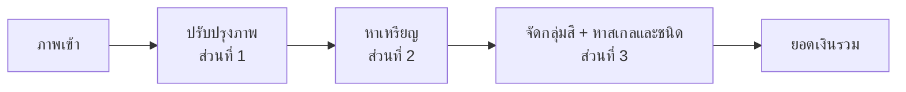

# baht-counter

เว็บแอปนับเหรียญและคำนวณยอดเงินไทยจากภาพถ่าย โครงงานวิชาการประมวลผลภาพและเสียง (ทีม 5 คน, 5 สัปดาห์)

ผู้ใช้ถ่ายหรืออัปโหลดภาพเหรียญที่วางบนพื้นราบ ระบบหาเหรียญทุกเหรียญ บอกชนิด และรวมยอดเงิน ถ้าระบบอ่านผิด ผู้ใช้แก้บนหน้าเว็บได้

แผนงานฉบับเต็มอยู่ที่ [`docs/plan.md`](docs/plan.md)

---

## ระบบทำอะไร

รองรับเหรียญไทยที่ใช้อยู่ปัจจุบัน 6 ชนิด

| ชนิด | รหัส | เส้นผ่านศูนย์กลาง (มม.) | กลุ่มสี |
|---|---|---|---|
| 25 สตางค์ | `THB_0_25` | 16 | copper |
| 50 สตางค์ | `THB_0_50` | 18 | copper |
| 1 บาท | `THB_1` | 20 | silver |
| 2 บาท | `THB_2` | 21.75 | gold |
| 5 บาท | `THB_5` | 24 | silver |
| 10 บาท | `THB_10` | 26 | bimetal |

**แนวคิดหลัก:** ภาพจากเว็บไม่มีไม้บรรทัด ระบบจึงใช้**สีแบ่งกลุ่มก่อน แล้วใช้ขนาดเทียบกันเอง** เพื่อหาสเกล (มม./พิกเซล) ที่ทำให้ทุกเหรียญตรงกับชนิดที่เป็นไปได้มากที่สุด ถ้าสเกลไม่ชัด ระบบตอบ `needs_confirmation` แล้วให้ผู้ใช้เลือกชนิดเหรียญ 1 เหรียญเป็นตัวอ้างอิง



## เทคโนโลยี

| ชั้น | เทคโนโลยี |
|---|---|
| Frontend | React + Vite + TypeScript, Tailwind CSS |
| Backend | Python 3.11 + FastAPI + Pydantic |
| ประมวลผลภาพ | OpenCV, NumPy, scikit-image (CNN เปรียบเทียบด้วย PyTorch) |
| ฐานข้อมูล | SQLite |
| Deploy | Docker Compose บนเซิร์ฟเวอร์ที่มี HTTPS |

## โครงสร้างโปรเจกต์

```text
baht-counter/
├── frontend/                 # ส่วนที่ 5
├── backend/
│   ├── app/                  # ส่วนที่ 4: FastAPI, routes, DB
│   │   └── pipeline.py       # เรียกโมดูลตามลำดับ
│   ├── modules/
│   │   ├── preprocess/       # ส่วนที่ 1
│   │   ├── detection/        # ส่วนที่ 2
│   │   └── classification/   # ส่วนที่ 3
│   ├── schemas/              # Pydantic schema กลาง (แก้ต้องผ่าน PR ที่ทุกคนเห็น)
│   └── tests/
├── data/
│   ├── samples/              # 5–10 ภาพตัวอย่างที่ทุกคนรันได้ (เก็บใน git)
│   ├── raw/                  # ภาพทั้งหมด (ไม่เก็บใน git)
│   ├── labels/               # ป้ายกำกับ JSON
│   └── splits.csv
├── eval/                     # สคริปต์ประเมินผล
├── docs/
└── docker-compose.yml
```

## การแบ่งงาน

| ส่วน | งาน | Issue | Branch |
|---|---|---|---|
| 1 | ชุดข้อมูล การปรับปรุงภาพ และการตรวจคุณภาพภาพ | [#1](https://github.com/Peem-Atikorn/baht-counter/issues/1) | `p1/Name` |
| 2 | หาตำแหน่งเหรียญ | [#2](https://github.com/Peem-Atikorn/baht-counter/issues/2) | `p2/Name` |
| 3 | จำแนกชนิดเหรียญ หาสเกล และการประเมินผลรวม | [#3](https://github.com/Peem-Atikorn/baht-counter/issues/3) | `p3/Name` |
| 4 | Backend API ฐานข้อมูล และ Deploy | [#4](https://github.com/Peem-Atikorn/baht-counter/issues/4) | `p4/Name` |
| 5 | Frontend เว็บแอป | [#5](https://github.com/Peem-Atikorn/baht-counter/issues/5) | `p5/Name` |

`Name` คือชื่อของผู้รับผิดชอบส่วนนั้น

ผู้รับผิดชอบแต่ละส่วนกด Assign ตัวเองใน issue ของส่วนนั้น

## การทำงานร่วมกัน

### Branch

```text
pX/Name  ──PR──▶  develop  ──PR (1 approve)──▶  main
```

| Branch | ใช้ทำอะไร | กฎ |
|---|---|---|
| `main` | เวอร์ชันที่ deploy และส่งอาจารย์ | รับเฉพาะ PR จาก `develop`, ต้องมี 1 คน approve |
| `develop` | รวมงานทุกส่วน (default branch) | ต้องเปิด PR, merge เองได้ |
| `pX/Name` | งานของส่วนที่ X | สร้างจาก `develop` |
| `docs/<ชื่องาน>` | เอกสารหรือของที่ใช้ร่วมกันทุกส่วน | สร้างจาก `develop` |

**ตั้งชื่อ branch**
- ขึ้นต้นด้วยเลขส่วนของตัวเอง `p1/` ถึง `p5/` แล้วตามด้วยชื่อตัวเอง เช่น `p2/Name`
- ใช้ภาษาอังกฤษ ไม่มีเว้นวรรค

### เริ่มต้นสำหรับสมาชิก (ทำครั้งแรกครั้งเดียว)

ตัวอย่างด้านล่างใช้ส่วนที่ 2 ให้เปลี่ยน `p2` และ `#2` เป็นเลขส่วนของตัวเอง และเปลี่ยน `Name` เป็นชื่อตัวเอง

**1. รับคำเชิญเข้า repo**
เปิด https://github.com/Peem-Atikorn/baht-counter/invitations แล้วกด **Accept invitation** (หรือกดจากอีเมลที่ GitHub ส่งมา)

**2. รับงาน**
เปิดแท็บ [Issues](https://github.com/Peem-Atikorn/baht-counter/issues) → กดเข้า issue ของส่วนตัวเอง → แถบขวาตรง **Assignees** กด **assign yourself**

**3. โหลดโปรเจกต์ลงเครื่อง**

```bash
git clone https://github.com/Peem-Atikorn/baht-counter.git
cd baht-counter
```

**4. สร้าง branch ของตัวเองจาก `develop` แล้วส่งขึ้น GitHub**

```bash
git switch develop
git switch -c p2/Name
git push -u origin p2/Name
```

### ทำงานประจำวัน

**1. ดึงงานล่าสุดของเพื่อนมาก่อนเริ่มทำงานทุกครั้ง**

```bash
git switch develop
git pull
git switch p2/Name
git merge develop
```

**2. แก้โค้ดแล้ว commit + push**

```bash
git add .
git commit -m "p2: เพิ่ม watershed แยกเหรียญที่ชิดกัน"
git push
```

**3. เปิด PR เข้า `develop`** เมื่องานชิ้นหนึ่งเสร็จและรันได้
- บน GitHub กด **Compare & pull request** (หรือแท็บ Pull requests → New pull request)
- ตรวจว่า base เป็น `develop` และ compare เป็น `p2/Name`
- ในคำอธิบาย PR เขียน `Refs #2` สำหรับงานย่อยระหว่างทาง หรือ `Closes #2` เมื่องานของส่วนนั้นเสร็จทั้งหมด
- กด **Merge pull request** ได้เลย ไม่ต้องรอคน approve (ถ้าอยากให้เพื่อนช่วยดู ให้เพิ่มชื่อใน Reviewers)

**4. ทำงานต่อบน branch เดิม** กลับไปทำข้อ 1 ใหม่

> push ตรงเข้า `develop` หรือ `main` ไม่ได้ ต้องผ่าน PR เสมอ ถ้า push แล้วขึ้น `protected branch` แปลว่าลืมสลับมา branch ของตัวเอง

### ข้อตกลง

- โมดูลประมวลผลภาพเป็นฟังก์ชัน Python บริสุทธิ์ และมี `mock_*()` คืนผลตัวอย่างตาม schema
- ค่าที่ประเมินไม่ได้เป็น `null` + `status` + `reason` ห้ามใช้ 0 แทน
- หน่วยอยู่ในชื่อฟิลด์ เช่น `diameter_px`, `value_baht`, `scale_mm_per_px`
- แก้ schema กลางต้องเปิด PR ที่ทุกคนเห็น และเพิ่ม `schema_version`

## การติดตั้งและรัน

_ยังไม่มี ส่วนที่ 4 จะเติมเมื่อมี `docker-compose.yml`_ (เป้าหมาย: `docker compose up` คำสั่งเดียว)
