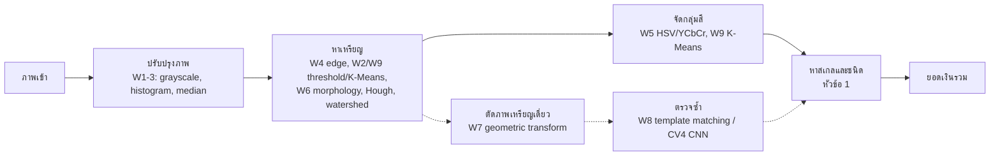

# แผนพัฒนาเว็บแอป: นับเหรียญและคำนวณยอดเงินไทย (Thai Coin Counter)

**วิชา:** การประมวลผลภาพและเสียง · **ทีม:** 5 คน · **ระยะเวลา:** 5 สัปดาห์ · **ชื่อ repo ที่เสนอ:** `baht-counter`

ผู้ใช้ถ่ายหรืออัปโหลดภาพเหรียญที่วางบนพื้นราบ ระบบหาเหรียญทุกเหรียญ บอกชนิด และรวมยอดเงิน ถ้าระบบอ่านผิด ผู้ใช้แก้บนหน้าเว็บได้

---

## 0. ขอบเขต

**รองรับ**
- เหรียญไทยที่ใช้อยู่ปัจจุบัน 6 ชนิด (ตามตารางด้านล่าง)
- ภาพถ่ายจากด้านบน หรือเอียงไม่เกิน ~30°
- เหรียญวางบนพื้นราบ อาจชิดกันได้ ซ้อนกันได้เล็กน้อย
- ภาพจากเว็บที่เห็นเหรียญชัด

**ไม่รองรับ (เขียนในรายงาน)**
- ธนบัตร (ทำเพิ่มได้ถ้ามีเวลา ดูหัวข้อ 6)
- เหรียญที่ซ้อนกันจนเห็นไม่ถึงครึ่งเหรียญ
- เหรียญต่างประเทศและเหรียญที่ระลึก (ระบบควรแจ้ง `unknown` ไม่ใช่เดา)
- เหรียญ 2 บาทสีเงินรุ่นเก่า (ก่อน พ.ศ. 2552) แยกจากเหรียญ 1 บาทยากมาก ให้ระบบแจ้ง `needs_confirmation`

### ข้อมูลเหรียญ

| ชนิด | รหัส | เส้นผ่านศูนย์กลาง (มม.) | สี | กลุ่มสี |
|---|---|---|---|---|
| 25 สตางค์ | `THB_0_25` | 16 | ทองแดง | copper |
| 50 สตางค์ | `THB_0_50` | 18 | ทองแดง | copper |
| 1 บาท | `THB_1` | 20 | เงิน | silver |
| 2 บาท | `THB_2` | 21.75 | ทอง | gold |
| 5 บาท | `THB_5` | 24 | เงิน (ขอบมีลาย) | silver |
| 10 บาท | `THB_10` | 26 | สองสี (ใจกลางทอง ขอบเงิน) | bimetal |

ส่วนที่ 1 ต้องวัดเหรียญจริงด้วยเวอร์เนียยืนยันค่าในตารางนี้ในสัปดาห์ 1

---

## 1. แนวคิดหลัก: ไม่ต้องรู้ขนาดจริงก็นับได้

ภาพจากเว็บไม่มีไม้บรรทัด ระบบจึงไม่รู้ว่า 1 พิกเซลเท่ากับกี่มิลลิเมตร ทางแก้คือใช้**สีแบ่งกลุ่มก่อน แล้วใช้ขนาดเทียบกันเอง**

1. หาเหรียญทุกเหรียญ ได้เส้นผ่านศูนย์กลาง `d_i` (พิกเซล) โดยใช้แกนยาวของวงรี เพื่อรองรับภาพที่ถ่ายเอียง
2. จัดกลุ่มสีของแต่ละเหรียญ `g_i` ∈ {copper, silver, gold, bimetal}
3. กลุ่มสีจำกัดชนิดที่เป็นไปได้ เช่น silver เป็นได้แค่ 1 หรือ 5 บาท ส่วน gold กับ bimetal มีชนิดเดียว
4. ค้นหาค่าสเกล `s` (มม./พิกเซล) ที่ทำให้ขนาดของทุกเหรียญตรงกับชนิดที่เป็นไปได้มากที่สุด

   `cost(s) = Σ_i min_{t ∈ ชนิดในกลุ่ม g_i} | d_i · s − D_t | / D_t`

5. ใช้ `s*` ที่ให้ cost ต่ำสุด แล้วกำหนดชนิดของทุกเหรียญ

**กรณีที่สเกลไม่ชัด:** ถ้าในภาพมีเหรียญกลุ่มเดียวขนาดเท่ากันหมด เช่น เหรียญเงินล้วนขนาดเดียว ระบบบอกไม่ได้ว่าเป็น 1 หรือ 5 บาท ให้ตอบ `needs_confirmation` แล้วให้ผู้ใช้กดเลือกชนิดเหรียญ 1 เหรียญ ระบบจะคำนวณสเกลจากเหรียญนั้นแล้วจัดชนิดเหรียญที่เหลือให้ใหม่

ส่วนนี้คือจุดเด่นของโครงงาน และเป็นสิ่งที่ต้องวัดผลเทียบกับวิธีพื้นฐานในรายงาน

### ไปป์ไลน์และเนื้อหาที่ใช้



| สัปดาห์ที่เรียน | ใช้ทำอะไรในโครงงาน |
|---|---|
| W1–2 | แปลง grayscale, Histogram Equalization/CLAHE, thresholding |
| W3 | Median filter ลดจุดรบกวนและลายพื้นโต๊ะ |
| W4 | Sobel/Canny หาขอบเหรียญ |
| W5 | HSV/YCbCr แยกเหรียญทองแดง เงิน ทอง และสองสี |
| W6 | Opening/Closing เติมรูในเหรียญ ลบจุดเล็ก, distance transform แยกเหรียญที่ติดกัน |
| W7 | หมุนและย่อขยายภาพเหรียญเดี่ยวให้เป็นขนาดมาตรฐาน, แก้ภาพเอียงจากวงรี |
| W8 | Template matching ยืนยันชนิดเหรียญจากลวดลาย (เช่น เลข 10 หรือลายขอบ 5 บาท) |
| W9 | K-Means แยกพื้นหลังกับเหรียญ และจัดกลุ่มสี |
| CV4 | CNN จำแนกภาพเหรียญเดี่ยว ใช้เป็นวิธีเปรียบเทียบ |

---

## 2. หน้าเว็บ

ใช้เป็นเว็บแอป เพราะอาจารย์เปิดจากมือถือ ถ่ายเหรียญ และเห็นผลได้ทันที โดยไม่ต้องติดตั้งอะไร

### หน้าที่ต้องมี

| หน้า | สิ่งที่มี |
|---|---|
| หน้าแรก | อธิบายระบบสั้น ๆ ปุ่ม "เริ่มนับเหรียญ" ลิงก์ประวัติ |
| ถ่าย/อัปโหลด | มีสองปุ่มเท่ากัน: **"ถ่ายรูป"** และ **"อัปโหลดรูป"** (รายละเอียดในหัวข้อถัดไป) พรีวิวก่อนส่ง และคำแนะนำสั้น ๆ เช่น "วางบนพื้นสีเรียบ ถ่ายจากด้านบน" |
| ผลลัพธ์ | ภาพพร้อมวงกลมรอบเหรียญ สีวงตามชนิด ป้ายมูลค่าบนเหรียญ, **ยอดรวมตัวใหญ่**, ตารางจำนวนเหรียญแต่ละชนิด, สถานะและเหตุผลถ้าระบบไม่แน่ใจ |
| แก้ผล (อยู่ในหน้าผลลัพธ์) | กดที่เหรียญเพื่อเปลี่ยนชนิดหรือลบ, กดบนภาพเพื่อเพิ่มเหรียญที่ระบบมองไม่เห็น, ยอดรวมคำนวณใหม่ทันที, เหรียญที่ผู้ใช้แก้มีป้าย "แก้ไขแล้ว" |
| ประวัติ | รายการภาพที่เคยนับ เปิดดูซ้ำ ดาวน์โหลดผล CSV/JSON |
| เกี่ยวกับ (สำหรับนำเสนอ) | แสดงผลแต่ละขั้นของไปป์ไลน์บนภาพเดียวกัน (ภาพเทา → ขอบ → mask → วงกลม → กลุ่มสี) เพื่อให้อาจารย์เห็นว่าใช้เทคนิคอะไร |

หน้า "เกี่ยวกับ" ควรทำ เพราะวิชานี้ให้คะแนนจากเทคนิคประมวลผลภาพ การเห็นภาพกลางทางทุกขั้นช่วยอธิบายตอนนำเสนอได้ดีกว่าการเห็นแค่ยอดเงิน

### การถ่ายรูปและอัปโหลดรูป (ต้องมีทั้งสองแบบ)

**ปุ่ม "ถ่ายรูป"**
- เปิดกล้องในหน้าเว็บด้วย `navigator.mediaDevices.getUserMedia` แสดงภาพสดเต็มจอ มีปุ่มชัตเตอร์ และปุ่มสลับกล้องหน้า/หลัง (มือถือเริ่มที่กล้องหลัง `facingMode: "environment"`)
- บนภาพสดมีกรอบนำสายตา และข้อความ "ถ่ายจากด้านบน ให้เห็นเหรียญครบทุกเหรียญ"
- กดชัตเตอร์แล้วจับภาพจาก `<video>` ลง `<canvas>` ที่ความละเอียดเต็มของกล้อง แล้วไปหน้าพรีวิว มีปุ่ม "ถ่ายใหม่" และ "ใช้รูปนี้"
- ใช้ได้ทั้งกล้องมือถือและเว็บแคมของโน้ตบุ๊ก
- **ทางสำรอง:** ถ้าเบราว์เซอร์ไม่ให้ใช้กล้อง (ผู้ใช้ไม่อนุญาต หรือไม่ใช่ HTTPS) ให้ใช้ `<input type="file" accept="image/*" capture="environment">` ซึ่งเปิดแอปกล้องของมือถือแทน พร้อมข้อความบอกเหตุผล

**ปุ่ม "อัปโหลดรูป"**
- เลือกไฟล์จากเครื่องหรือคลังภาพ (`<input type="file" accept="image/jpeg,image/png,image/webp,image/heic">`)
- ลากไฟล์มาวางในกรอบได้ (drag and drop) บนคอมพิวเตอร์
- **วางภาพจากคลิปบอร์ดได้ (Ctrl+V):** อาจารย์คัดลอกภาพจากเว็บแล้ววางได้ทันที ไม่ต้องบันทึกไฟล์ก่อน
- ตรวจชนิดและขนาดไฟล์ฝั่งเว็บก่อนส่ง (เช่น ไม่เกิน 15 MB) และแสดงข้อความภาษาไทยถ้าไม่ผ่าน

**ทั้งสองแบบ**
- ส่งภาพความละเอียดเต็มให้ backend ไม่บีบอัดฝั่งเว็บจนเหรียญเล็กเสียรายละเอียด (backend เป็นคนย่อเอง)
- ภาพจากกล้องในหน้าเว็บไม่มี EXIF orientation จึงหมุนให้ถูกก่อนส่ง ส่วนภาพที่อัปโหลดให้ backend อ่าน EXIF
- `getUserMedia` ใช้ได้เฉพาะ HTTPS หรือ `localhost` ช่วงพัฒนาจึงทดสอบกล้องบนคอมพิวเตอร์ได้ แต่ทดสอบบนมือถือต้องรอ deploy HTTPS (สัปดาห์ 3) หรือใช้ tunnel ที่มี HTTPS

หน้าแก้ผลยังใช้เป็น**เครื่องมือทำป้ายกำกับข้อมูล**ได้ด้วย: ให้ระบบเดาก่อน แล้วคนแก้ให้ถูก จะเร็วกว่าวาดวงกลมเองทุกเหรียญ

### เทคโนโลยี

| ชั้น | เทคโนโลยี | เหตุผล |
|---|---|---|
| Frontend | React + Vite + TypeScript, Tailwind CSS | |
| วาดวงกลมบนภาพ | SVG ซ้อนบนรูป | วงกลมกับป้ายเป็นแค่รูปทรงง่าย ไม่ต้องใช้ไลบรารี canvas |
| Backend | Python 3.11 + FastAPI + Pydantic | ใช้ OpenCV ได้ตรง ๆ, มีเอกสาร API อัตโนมัติ |
| ประมวลผลภาพ | OpenCV, NumPy, scikit-image | |
| CNN (ส่วนเปรียบเทียบ) | PyTorch, โมเดลเล็กเช่น MobileNetV3 | |
| ฐานข้อมูล | SQLite | งานเล็ก ไม่ต้องใช้ฐานข้อมูลใหญ่ |
| Deploy | Render free tier: Web Service เดียวจาก `Dockerfile` (backend เสิร์ฟ frontend ที่ build แล้วด้วย) https://baht-counter.onrender.com; ในเครื่องใช้ Docker Compose | ฟรี มี HTTPS อัตโนมัติ ไม่ต้องใส่บัตร URL เดียวไม่ต้องตั้ง CORS (ข้อจำกัดดูหัวข้อ 7) |

ประมวลผลภาพเดียวควรเสร็จใน 1–2 วินาที จึงตอบกลับทันทีได้ ไม่ต้องทำ background job หรือ polling

---

## 3. ข้อตกลงร่วมของทั้งทีม (สัปดาห์ 1)

### 3.1 โครงสร้าง repository

```text
baht-counter/
├── frontend/                 # ส่วนที่ 5
├── backend/
│   ├── app/                  # ส่วนที่ 4: FastAPI, routes, DB
│   │   └── pipeline.py       # เรียกโมดูลตามลำดับ
│   ├── modules/
│   │   ├── preprocess/       # ส่วนที่ 1
│   │   ├── detection/        # ส่วนที่ 2
│   │   └── classification/   # ส่วนที่ 3
│   ├── schemas/              # Pydantic schema กลาง (แก้ต้องผ่าน PR ที่ทุกคนเห็น)
│   └── tests/
├── data/
│   ├── samples/              # 5–10 ภาพตัวอย่างที่ทุกคนรันได้ (เก็บใน git)
│   ├── raw/                  # ภาพทั้งหมด (ไม่เก็บใน git, ดึงด้วย scripts/download_data.py)
│   ├── labels/               # ป้ายกำกับ JSON
│   └── splits.csv
├── eval/                     # สคริปต์ประเมินผล
├── docs/
└── docker-compose.yml
```

### 3.2 กติกาการเชื่อมต่อ

- โมดูลประมวลผลภาพเป็นฟังก์ชัน Python บริสุทธิ์ รับ object เข้า คืน object ออก ไม่แตะฐานข้อมูลหรือไฟล์เอง
- ทุกโมดูลมีฟังก์ชัน `mock_*()` คืนผลตัวอย่างตาม schema ใช้ได้ตั้งแต่วันแรก
- ค่าที่ประเมินไม่ได้เป็น `null` + `status` + `reason` ห้ามใช้ 0 แทน
- `status`: `ok` / `needs_confirmation` / `failed`
- `source` ของชนิดเหรียญ: `estimated` / `user_edited` / `user_added`
- หน่วยอยู่ในชื่อฟิลด์: `diameter_px`, `diameter_mm`, `value_baht`, `scale_mm_per_px`

### 3.3 Schema กลาง (ร่าง)

```python
class Coin(BaseModel):
    coin_id: int
    center_xy: tuple[float, float]       # พิกัดบนภาพที่ส่งกลับให้ frontend
    radius_px: float
    ellipse: tuple[float, float, float] | None  # แกนยาว, แกนสั้น, มุม (ถ้าภาพเอียง)
    color_group: Literal["copper", "silver", "gold", "bimetal", "unknown"]
    coin_type: Literal["THB_0_25", "THB_0_50", "THB_1", "THB_2", "THB_5", "THB_10", "unknown"] | None
    value_baht: float | None
    confidence: float | None
    source: Literal["estimated", "user_edited", "user_added"]
    status: Literal["ok", "needs_confirmation", "failed"]
    reason: str | None

class CountResult(BaseModel):
    schema_version: str
    image_size: tuple[int, int]
    coins: list[Coin]
    total_baht: float | None
    scale_mm_per_px: float | None
    scale_source: Literal["inferred", "user_anchor"] | None
    status: Literal["ok", "needs_confirmation", "failed"]
    reason: str | None
    debug_images: dict[str, str]         # ภาพกลางทางสำหรับหน้า "เกี่ยวกับ"
```

### 3.4 สัญญาของแต่ละโมดูล

```python
# ส่วนที่ 1
def preprocess(image) -> PreprocessResult: ...          # ภาพที่ปรับแล้ว + ผลตรวจคุณภาพ

# ส่วนที่ 2
def detect_coins(pre: PreprocessResult) -> list[Coin]: ...  # ยังไม่มี color_group / coin_type

# ส่วนที่ 3
def classify_coins(pre: PreprocessResult, coins: list[Coin],
                   anchor: tuple[int, str] | None = None) -> CountResult: ...
```

### 3.5 วิธีทำงานร่วมกัน

- Branch ต่อฟีเจอร์ เช่น `p2/watershed` → Pull Request → อีก 1 คนตรวจ → merge เข้า `main`
- เปลี่ยน schema กลาง ต้องเปิด PR ที่ทุกคนเห็น และเพิ่ม `schema_version`
- CI บน GitHub Actions: รัน `pytest` และ `npm run build` ทุก PR
- ประชุม 15 นาที สัปดาห์ละ 2 ครั้ง: แต่ละคนบอกสิ่งที่เสร็จ สิ่งที่ติด และตัวเลขผลทดลองล่าสุด

---

## 4. การแบ่งงาน 5 ส่วน

### ส่วนที่ 1: ชุดข้อมูล การปรับปรุงภาพ และการตรวจคุณภาพภาพ

**เป้าหมาย:** ทีมมีชุดข้อมูลที่มีป้ายกำกับครบ และทุกภาพที่เข้าระบบถูกปรับให้พร้อมใช้ หรือถูกปฏิเสธพร้อมเหตุผล

**งานหลัก**
- [ ] วัดเหรียญจริงทุกชนิดด้วยเวอร์เนีย ยืนยันตารางขนาด
- [ ] เขียนโปรโตคอลถ่ายภาพ: พื้นหลังอย่างน้อย 3 แบบ (กระดาษขาว, โต๊ะไม้, ผ้าสีเข้ม), แสง 2–3 แบบ, มุมตรงและเอียง, จำนวน 3–30 เหรียญต่อภาพ, มีภาพเหรียญชิดกันและซ้อนกันเล็กน้อย, คละหัวและก้อย
- [ ] เก็บภาพของทีม ~150 ภาพ และภาพจากเว็บ ~30 ภาพ (บันทึกแหล่งที่มา)
- [ ] กำหนดรูปแบบไฟล์ป้ายกำกับ (JSON: วงกลม + ชนิดต่อเหรียญ) และจัดทำ `splits.csv` (ชุดปรับระบบ / ชุดทดสอบ / ชุดภาพเว็บ)
- [ ] ฟังก์ชัน `preprocess`: ย่อภาพให้ด้านยาวคงที่ (เช่น 1600 px), อ่าน EXIF orientation, grayscale, CLAHE, median filter
- [ ] ทดลองว่า Histogram Equalization / CLAHE / White balance ช่วยการหาเหรียญและการจัดกลุ่มสีหรือไม่
- [ ] ตรวจคุณภาพภาพ: เบลอ (Laplacian variance), มืดหรือสว่างเกิน (histogram), ภาพเล็กเกินไป
- [ ] ข้อความเหตุผลภาษาไทยที่ผู้ใช้เข้าใจ เช่น "ภาพเบลอ กรุณาถือกล้องให้นิ่ง"

**สิ่งที่ส่งต่อ:** `PreprocessResult` (ภาพที่ปรับแล้ว, ภาพเทา, สเกลที่ย่อ, status, reason), ชุดข้อมูล + ป้ายกำกับ + `splits.csv`

**เกณฑ์เสร็จ**
- ชุดข้อมูลครบตามโปรโตคอล มีทุกชนิดเหรียญอย่างน้อยชนิดละ 80 เหรียญ
- ภาพเสียทุกประเภทในชุดทดสอบถูกปฏิเสธพร้อมเหตุผลที่ถูกต้อง
- มีตารางเปรียบเทียบผลก่อน/หลังปรับปรุงภาพ

---

### ส่วนที่ 2: หาตำแหน่งเหรียญ

**เป้าหมาย:** ได้วงกลม (หรือวงรี) ของทุกเหรียญในภาพ รวมถึงเหรียญที่ชิดกัน

**งานหลัก**
- [ ] แยกเหรียญออกจากพื้นหลัง: ทดลอง Otsu threshold, K-Means, ขอบ Sobel/Canny แล้วเลือกวิธีด้วยผลบนชุดปรับระบบ
- [ ] Morphology: closing เติมรูในเหรียญ, opening ลบจุดเล็ก
- [ ] แยกเหรียญที่ชิดกันด้วย distance transform + watershed
- [ ] หาวงกลมด้วย Hough Circle เป็นอีกวิธีเปรียบเทียบ
- [ ] Fit ellipse ต่อเหรียญ เพื่อรองรับภาพที่ถ่ายเอียง (ใช้แกนยาวเป็นเส้นผ่านศูนย์กลาง)
- [ ] กรองสิ่งที่ไม่ใช่เหรียญ: ความกลม (circularity), ขนาดเทียบกับเหรียญอื่น
- [ ] ฟังก์ชันรับ "เหรียญที่ผู้ใช้เพิ่ม" (จุดที่ผู้ใช้กด) แล้วหาวงกลมรอบจุดนั้น
- [ ] ส่งภาพกลางทาง (mask, ขอบ, distance map) ให้หน้า "เกี่ยวกับ"

**สิ่งที่ส่งต่อ:** `list[Coin]` ที่มี `center_xy`, `radius_px`, `ellipse`

**เกณฑ์เสร็จ**
- Precision และ Recall ของการหาเหรียญบนชุดทดสอบ (นับว่าถูกเมื่อจุดศูนย์กลางห่างไม่เกินครึ่งรัศมี) เสนอเป้า ≥ 0.95
- ความคลาดของรัศมีเฉลี่ยไม่เกิน 3% (จำเป็นต่อการแยก 25/50 สตางค์ ที่ขนาดต่างกันแค่ 12%)
- มีตารางเปรียบเทียบ threshold vs K-Means vs Hough และผลแยกเหรียญที่ชิดกัน มี/ไม่มี watershed

---

### ส่วนที่ 3: จำแนกชนิดเหรียญ หาสเกล และการประเมินผลรวม

**เป้าหมาย:** บอกชนิดเหรียญได้ถูกโดยไม่ต้องรู้ขนาดจริง และพิสูจน์ด้วยตัวเลขว่าวิธีหาสเกลดีกว่าวิธีพื้นฐาน

**งานหลัก**
- [ ] จัดกลุ่มสีต่อเหรียญ: ใช้ค่า HSV/YCbCr ของบริเวณกลางเหรียญและวงแหวนขอบ (10 บาทต่างสีระหว่างกลางกับขอบ), ตัดบริเวณแสงสะท้อน
- [ ] อัลกอริทึมหาสเกลตามหัวข้อ 1 และจัดการกรณีสเกลไม่ชัด (`needs_confirmation`)
- [ ] รับ `anchor` จากผู้ใช้ (เหรียญที่ผู้ใช้บอกชนิด) แล้วคำนวณใหม่
- [ ] **วิธีพื้นฐาน:** ใช้ช่วงรัศมีพิกเซลคงที่ต่อชนิด (สมมติถ่ายจากความสูงเดิมทุกครั้ง) ไม่ใช้สี
- [ ] (ถ้าทัน) Template matching ยืนยัน 1 vs 5 บาท จากลวดลาย, หรือ CNN จำแนกภาพเหรียญเดี่ยวเป็นวิธีเปรียบเทียบ
- [ ] คำนวณยอดเงินรวม
- [ ] **เจ้าของสคริปต์ประเมินผลรวม** `eval/run_eval.py`: รันทั้งไปป์ไลน์บนชุดทดสอบ ออกตารางผลทุกตัวชี้วัด และ confusion matrix

**สิ่งที่ส่งต่อ:** `CountResult` ที่มี `color_group`, `coin_type`, `value_baht`, `total_baht`, `scale_mm_per_px`

**เกณฑ์เสร็จ**
- Accuracy การจำแนกชนิดรายเหรียญบนชุดทดสอบ เสนอเป้า ≥ 0.90 พร้อม confusion matrix
- % ภาพที่ยอดรวมถูกพอดี และค่าคลาดเฉลี่ยของยอดรวม (บาท)
- ตารางเปรียบเทียบ: วิธีพื้นฐาน vs สี + หาสเกล (vs CNN) บนชุดทดสอบของทีม และชุดภาพเว็บ
- `run_eval.py` รันได้ด้วยคำสั่งเดียวและผลซ้ำได้

---

### ส่วนที่ 4: Backend API ฐานข้อมูล และ Deploy

**เป้าหมาย:** รับภาพ เรียกโมดูลตามลำดับ เก็บผล และให้หน้าเว็บแก้ผลได้

**งานหลัก**
- [ ] ตั้งโปรเจกต์ FastAPI, Pydantic schema กลาง, SQLite, โฟลเดอร์ `storage/`
- [ ] `pipeline.py`: preprocess → detect → classify พร้อมจัดการสถานะล้มเหลวทุกขั้น, สลับโมดูลจริงกับ mock ได้ด้วย config
- [ ] ตรวจไฟล์ที่อัปโหลด: ชนิดไฟล์ ขนาดไม่เกินกำหนด
- [ ] บันทึก log: เวลาแต่ละขั้น, จำนวนครั้งที่ผู้ใช้แก้ผล (ใช้เป็นตัวชี้วัดในรายงาน)
- [ ] Export ป้ายกำกับจากผลที่ผู้ใช้แก้แล้ว เพื่อใช้หน้าเว็บเป็นเครื่องมือทำป้ายกำกับ
- [ ] Dockerfile และ `docker-compose.yml`
- [x] Deploy ขึ้น Render free tier (มี HTTPS): Web Service เดียวจาก `Dockerfile` ที่ root, region Singapore, deploy อัตโนมัติเมื่อมี commit เข้า `develop`, env `PORT=8000` และ `COIN_USE_MOCK` (ใส่ชื่อขั้นที่ยังเป็น mock คั่นด้วย comma หรือ `0` เมื่อโมดูลจริงเสร็จครบ), health check `/api/coin-types`

**API ที่ต้องมี**

| Method | Path | ใช้ทำอะไร |
|---|---|---|
| GET | `/api/coin-types` | รายการชนิดเหรียญ ขนาด มูลค่า สีที่ใช้แสดง |
| POST | `/api/analyses` | อัปโหลดภาพ → ได้ `CountResult` และ `analysis_id` ทันที |
| GET | `/api/analyses/{id}` | ผลของภาพนั้น |
| GET | `/api/analyses/{id}/images/{name}` | ภาพต้นฉบับ และภาพกลางทาง |
| PUT | `/api/analyses/{id}/coins/{coin_id}` | ผู้ใช้เปลี่ยนชนิดเหรียญ (ถ้าเป็น anchor ให้คำนวณสเกลใหม่ทั้งภาพ) |
| POST | `/api/analyses/{id}/coins` | ผู้ใช้เพิ่มเหรียญที่ระบบมองไม่เห็น (ส่งจุดที่กด) |
| DELETE | `/api/analyses/{id}/coins/{coin_id}` | ลบสิ่งที่ไม่ใช่เหรียญ |
| GET | `/api/history` | ประวัติ |
| GET | `/api/analyses/{id}/export` | ดาวน์โหลด JSON/CSV |

**เกณฑ์เสร็จ**
- ทุก endpoint มี test อย่างน้อย 1 กรณีปกติ + 1 กรณีล้มเหลว
- ภาพขนาดปกติประมวลผลเสร็จภายใน 2 วินาทีบนเซิร์ฟเวอร์จริง
- `docker compose up` รันทั้งระบบได้ด้วยคำสั่งเดียว

---

### ส่วนที่ 5: Frontend เว็บแอป

**เป้าหมาย:** ผู้ใช้ถ่ายภาพจนเห็นยอดเงินได้บนมือถือและคอมพิวเตอร์ และแก้ผลได้ง่าย

**งานหลัก**
- [ ] ตั้งโปรเจกต์ React + Vite + TypeScript + Tailwind, routing, layout ใช้ได้บนจอมือถือ
- [ ] สร้าง type จาก OpenAPI ของ backend (`openapi-typescript`)
- [ ] ชั้น API client + mock (MSW) ให้พัฒนาได้ก่อน backend เสร็จ
- [ ] ปุ่ม "ถ่ายรูป": กล้องสดด้วย `getUserMedia`, ชัตเตอร์, สลับกล้องหน้า/หลัง, ทางสำรอง `<input capture>`
- [ ] ปุ่ม "อัปโหลดรูป": เลือกไฟล์, ลากวาง, วางจากคลิปบอร์ด, ตรวจชนิดและขนาดไฟล์
- [ ] หน้าพรีวิว: "ถ่ายใหม่ / เลือกใหม่" และ "ใช้รูปนี้"
- [ ] หน้าผลลัพธ์: SVG วงกลมซ้อนบนภาพ สีตามชนิด ป้ายมูลค่า ยอดรวม ตารางสรุป
- [ ] แก้ผล: กดเหรียญเพื่อเปลี่ยนชนิด/ลบ, กดบนภาพเพื่อเพิ่ม, ป้าย "แก้ไขแล้ว"
- [ ] แสดงสถานะชัดเจน: `needs_confirmation` มีข้อความบอกว่าให้ทำอะไร เช่น "กดเลือกชนิดของเหรียญ 1 เหรียญ เพื่อให้ระบบคำนวณที่เหลือ"
- [ ] ค่า `null` แสดงเป็น "ระบุไม่ได้" ไม่แสดงเป็น 0
- [ ] หน้า "เกี่ยวกับ" แสดงภาพกลางทางของไปป์ไลน์
- [ ] หน้าประวัติ

**เกณฑ์เสร็จ**
- ทำครบทุกขั้นบนมือถือจริง 1 เครื่องและคอมพิวเตอร์ 1 เครื่อง
- ถ่ายรูปได้ทั้ง Android (Chrome) และ iPhone (Safari) ผ่าน HTTPS และเว็บแคมโน้ตบุ๊ก
- อัปโหลดได้ทั้งเลือกไฟล์ ลากวาง และวางจากคลิปบอร์ด
- ทุกสถานะล้มเหลวจาก backend มีหน้าจอรองรับ ไม่มีหน้าค้างหรือหน้าว่าง
- ผู้ใช้ใหม่ 3 คนนับเหรียญและแก้ผลได้โดยไม่ต้องถาม (ทดสอบในสัปดาห์ 4)

---

## 5. แผนรายสัปดาห์

เติมวันที่ตามกำหนดส่งจริงของวิชา

**ตารางนี้คือลำดับงานและกำหนดส่งช้าสุด ไม่ใช่ข้อจำกัดเวลา** ถ้างานที่ต้องเสร็จก่อนเสร็จแล้ว ทำงานถัดไปได้ทันทีไม่ต้องรอสัปดาห์ถัดไป งานที่ต้องรอจริงคืองานที่ต้องใช้ผลจากงานอื่น เช่น ปรับความแม่นต้องรอชุดข้อมูลที่มีป้ายกำกับ, ทดสอบกล้องบนมือถือต้องรอ deploy HTTPS

| สัปดาห์ | ส่วนที่ 1 | ส่วนที่ 2 | ส่วนที่ 3 | ส่วนที่ 4 | ส่วนที่ 5 | จุดตรวจของทีม |
|---|---|---|---|---|---|---|
| 1 | วัดเหรียญ, โปรโตคอลถ่าย, ภาพชุดแรก 30 ภาพ | ทดลองแยกพื้นหลังบนภาพชุดแรก | ทดลองค่าสีของแต่ละชนิดใน HSV/YCbCr | FastAPI + schema + mock pipeline | โครงเว็บ, ปุ่มอัปโหลดรูป + ถ่ายรูป (ทดสอบบน localhost), mock API | schema ล็อก, `data/samples/` พร้อม |
| 2 | `preprocess` + ตรวจคุณภาพภาพ, เก็บภาพเพิ่ม | หาเหรียญเดี่ยวได้ + Hough | วิธีพื้นฐาน + จัดกลุ่มสี | API ครบชุดแรก, SQLite | หน้าผลลัพธ์ (ยังแก้ไม่ได้) | **ระบบครบวงจรบนเว็บ** แม้ผลยังไม่แม่น |
| 3 | เก็บภาพครบ ~150 + ภาพเว็บ, ทำป้ายกำกับ | watershed แยกเหรียญที่ชิดกัน, fit ellipse | อัลกอริทึมหาสเกล + anchor, `run_eval.py` | Docker, deploy HTTPS | แก้ผลบนหน้าเว็บ, กล้องมือถือ | **ล็อกชุดทดสอบ** |
| 4 | ทดลองผลของการปรับปรุงภาพ | ตารางเปรียบเทียบวิธีหาเหรียญ | template matching / CNN (ถ้าทัน), ตารางเปรียบเทียบ | export, history, test ครบ | หน้าเกี่ยวกับ, ประวัติ, ทดสอบกับผู้ใช้ 3 คน | หยุดเพิ่มฟีเจอร์ปลายสัปดาห์ |
| 5 | บทข้อมูลและการปรับปรุงภาพ | บทการหาเหรียญ | บทการจำแนกและผลทดลอง | README, ขั้นตอนติดตั้ง | แก้บั๊ก UI, อัดคลิปสาธิต | ส่งรายงาน สไลด์ คลิป source code |

**กติกาจุดตรวจสัปดาห์ 3:** ห้ามปรับระบบโดยดูผลจากชุดทดสอบหลังล็อกแล้ว ใช้ชุดปรับระบบเท่านั้น

---

## 6. งานเสริม (ทำเมื่องานหลักเสร็จ)

- นับธนบัตรไทยด้วยสี (HSV) + template matching
- แยกด้านหัว/ก้อย
- โหมดวิดีโอแบบเรียลไทม์จากกล้อง
- คำนวณ "ควรทอนเงินอย่างไร" จากยอดที่นับได้

---

## 7. ความเสี่ยง

| ความเสี่ยง | วิธีรับมือ | เจ้าของ |
|---|---|---|
| 25 กับ 50 สตางค์ ขนาดต่างกันแค่ 2 มม. | วัดรัศมีละเอียดด้วย fit ellipse ระดับ sub-pixel, ถ้าไม่ชัดให้ `needs_confirmation` | 2, 3 |
| แสงสะท้อนบนเหรียญเงินทำให้สีเพี้ยน | ตัดพิกเซลที่สว่างจัดก่อนวัดสี, ใช้ค่ามัธยฐานแทนค่าเฉลี่ย | 3 |
| เหรียญชิดหรือซ้อนกัน | distance transform + watershed, ใช้เฉพาะส่วนขอบที่เห็นในการ fit วงกลม | 2 |
| เงาของเหรียญทำให้ขอบผิด | ทดลองแยกด้วยสี (ช่อง S/V) แทนภาพเทา | 1, 2 |
| พื้นหลังมีลาย (โต๊ะไม้, ผ้า) | median filter, K-Means, ใส่ภาพพื้นหลังหลายแบบในชุดข้อมูล | 1, 2 |
| ภาพเว็บมีเหรียญชนิดเดียว สเกลไม่ชัด | `needs_confirmation` + anchor จากผู้ใช้ | 3, 5 |
| เหรียญ 2 บาทสีเงินรุ่นเก่า | อยู่นอกขอบเขต, ระบบแจ้งเตือนเมื่อเจอเหรียญเงินขนาดอยู่ระหว่าง 1 กับ 5 บาท | 3 |
| กล้องในหน้าเว็บเปิดไม่ได้บนมือถือ (ไม่มี HTTPS, ผู้ใช้ไม่อนุญาต, Safari บน iPhone) | deploy HTTPS สัปดาห์ 3, ทางสำรอง `<input capture>`, ทดสอบบน iPhone และ Android จริงในสัปดาห์ 3 | 4, 5 |
| ข้อจำกัด Render free tier: หลับเมื่อว่าง 15 นาที (เปิดครั้งแรกรอ ~1 นาที), RAM 512MB, ไม่มีดิสก์ถาวร (SQLite และ `storage/` หายเมื่อ deploy ใหม่หรือ restart) | ปลุกเซิร์ฟเวอร์ก่อน demo, ทดสอบภาพ 1600 px ว่าไม่เกิน RAM, export ป้ายกำกับก่อน deploy ใหม่, ถ้าไม่พอค่อยย้ายไป Hugging Face Spaces หรือ VM | 4 |
| เหรียญเล็กเสียรายละเอียดเพราะภาพถูกบีบอัด | ส่งภาพความละเอียดเต็ม ให้ backend ย่อเอง | 4, 5 |
| เวลาไปหมดกับความสวยของหน้าเว็บ | ทำให้ใช้งานได้ก่อน ตกแต่งเฉพาะสัปดาห์ 4 | 5 |

---

## 8. สิ่งที่ต้องส่งมอบ

1. เว็บแอปที่เข้าใช้ได้ผ่าน URL (HTTPS) และรันในเครื่องได้ด้วย `docker compose up`
2. Source code พร้อม README
3. เอกสาร API (`/docs`) และ schema กลาง
4. ชุดข้อมูลภาพ ป้ายกำกับ และ `splits.csv`
5. ผลจาก `eval/run_eval.py` พร้อมเปรียบเทียบกับวิธีพื้นฐาน ทั้งชุดทดสอบของทีมและชุดภาพเว็บ
6. รายงาน สไลด์ และคลิปสาธิต
