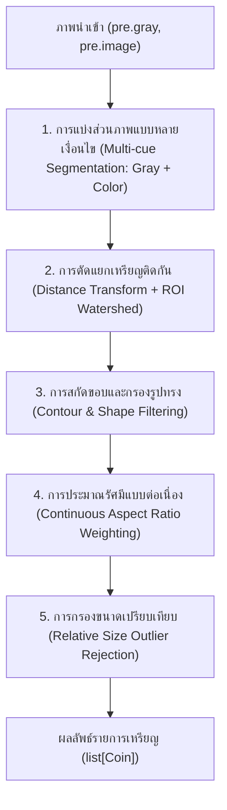

# บทที่ 2 การตรวจหาตำแหน่งเหรียญ (ส่วนที่ 2)

> ร่างบทรายงานของส่วนที่ 2: การตรวจหาตำแหน่งและขอบเขตเหรียญ (Detection)
> ไฟล์อ้างอิง: `backend/modules/detection/`, `eval/detection_baselines.py`, `eval/results/detection_baselines_tune.*`, `eval/results/detection_baselines_test.*`

---

## 2.1 ภาพรวมสถาปัตยกรรม (Architecture Overview)

เป้าหมายของส่วนที่ 2 คือการระบุตำแหน่งศูนย์กลาง $(c_x, c_y)$ รัศมีโดยประมาณ ($r$) และพารามิเตอร์วงรี (Major axis, Minor axis, Angle) ของเหรียญทุกเหรียญในภาพถ่าย เพื่อส่งต่อให้ส่วนที่ 3 นำไปจำแนกชนิดเหรียญและคำนวณยอดเงิน



กระบวนการตรวจหาเหรียญทำงานตามลำดับ 5 ขั้นตอนหลัก ดังนี้:

### 1. การแบ่งส่วนภาพแบบหลายเงื่อนไข (Multi-cue Segmentation)
อินพุตรับทั้งภาพเทา (`pre.gray`) และภาพสี (`pre.image`) เพื่อรวมสัญญาณตรวจจับ 2 ช่องทาง (`backend/modules/detection/segment.py`):
- **การชดเชยแสงไม่สม่ำเสมอ (Background Illumination Correction):** ประเมินแนวโน้มแสงกว้างๆ (Global Illumination Trend) ทั้งภาพเทาและภาพสีด้วย Downsampled Median Filter (ย่อภาพ $16\times$ แล้วรัน Median Blur หน้าต่างกว้าง $71\times 71$) เพื่อแก้ไขปัญหาเงาขอบภาพหรือการไล่ระดับแสง โดยไม่กลืนกลุ่มเหรียญที่วางติดกัน
- **Intensity Cue:** คำนวณ Otsu Thresholding บนภาพเทาที่ชดเชยแสงแล้ว เพื่อจับเหรียญที่มีความสว่างแตกต่างจากพื้นหลังอย่างชัดเจน พร้อมระบบตรวจสอบและกลับค่า (Invert) อัตโนมัติหากพื้นหลังเป็นสีขาว
- **Color Difference Cue:** คำนวณระยะห่างทางสี (Euclidean Color Distance ในปริภูมิสี BGR) ระหว่างพิกเซลในภาพกับสีพื้นหลังที่ประเมินได้จากขอบภาพ แล้วตัดแบ่งด้วย Otsu Thresholding ช่วยให้ตรวจจับเหรียญที่ความสว่างกลืนไปกับพื้นหลังได้ เช่น เหรียญเงินบนกระดาษขาว หรือเหรียญทองแดงบนพื้นผ้าสีเข้ม
- **การรวมหน้ากากและการเติมเต็มสัณฐานวิทยา:** ผสานหน้ากากไบนารีจากทั้งสองสัญญาณด้วยการทำ Bitwise OR (`cv2.bitwise_or(mask_gray, mask_color)`) ตามด้วย Morphological Closing ($5 \times 5$) และการเติมเต็มช่องว่างภายใน (`fill_internal_holes`) โดยจำกัดขนาดรูสูงสุดไม่เกิน $\pi \times 35^2$ พิกเซล เพื่อเติมแสงสะท้อน (Specular Highlight) บนผิวเหรียญโดยไม่เชื่อมออบเจกต์รอบข้างเข้าด้วยกัน

### 2. การตัดแยกกลุ่มเหรียญที่สัมผัสกัน (Touching Coins Separation)
เมื่อเหรียญวางชิดกัน ขอบเขตไบนารีจะรวมเป็นกลุ่มก้อน (Cluster) ระบบจึงใช้ Watershed Transform:
- คำนวณ **Euclidean Distance Transform ($L_2$)** บนหน้ากากไบนารี เพื่อหาระยะห่างจากทุกพิกเซลไปยังขอบที่ใกล้ที่สุด
- หา Local Peak ของระยะทางเพื่อใช้เป็น **Seed Markers** จุดศูนย์กลางของแต่ละเหรียญ
- ทำ **Morphological Dilation** และกำหนดพื้นที่ที่ไม่ใช่เหรียญเป็นฉลากพื้นหลัง (Background Marker = 1)
- เพื่อประสิทธิภาพความเร็ว ระบบใช้ **Cropped ROI Watershed** โดยตัดเฉพาะพื้นที่ Bounding Box ของกลุ่มเหรียญพร้อมขอบเผื่อ ($\text{pad} = 15\text{ px}$) มารัน Watershed ขยายขอบเขตจาก Marker จนกระทั่งชนกันที่แนวน้ำท่วม (Watershed Ridge Lines)

### 3. การสกัด Contour และกรองคุณลักษณะรูปทรง (Shape Filtering)
สำหรับแต่ละ Marker ในภาพผลลัพธ์:
- หาเส้นรอบรูปภายนอก (Contour)
- ตรวจสอบพื้นที่ (Area): ต้องมีขนาดอย่างน้อย $\text{min\_area\_px} = 250.0 \text{ px}$ เพื่อกรองเศษจุดรบกวนขนาดเล็ก
- ตรวจสอบความกลม (Circularity):
  $$\text{Circularity} = \frac{4 \pi \cdot \text{Area}}{\text{Perimeter}^2} \ge 0.65$$
  *หมายเหตุ:* วัตถุสี่เหลี่ยมจัตุรัสที่มีขอบเรียบสมบูรณ์ตามทฤษฎีจะมีค่าความกลม $\frac{\pi}{4} \approx 0.785$ ซึ่งผ่านเกณฑ์ 0.65 ได้ เกณฑ์ Circularity จึงมีหน้าที่หลักในการตัดสิ่งรบกวนรูปทรงเรียวยาว (เช่น ปากกาหรือแถบเส้น) และขอบที่มีรอยหยักขรุขระ ส่วนวัตถุสี่เหลี่ยมขนาดเล็กบนลายผ้านั้นจะถูกคัดกรองออกด้วยเกณฑ์พื้นที่ $\ge 250\text{ px}$ และการกรองขนาดสัมพันธ์ในขั้นถัดไป

### 4. การ Fit วงรีและประมาณรัศมีแบบต่อเนื่อง (Continuous Ellipse Fitting)
ใช้ `cv2.fitEllipse` บนจุด Contour เพื่อรองรับทั้งภาพถ่ายมุมตรงและมุมเอียง และคำนวณรัศมีด้วยการถ่วงน้ำหนักต่อเนื่องตามอัตราส่วนแกนวงรี (Aspect Ratio) เพื่อป้องกันการกระโดดของขนาด (รายละเอียดในหัวข้อ 2.2)

### 5. การกรองขนาดสัมพัทธ์ (Relative Size Outlier Rejection)
เปรียบเทียบขนาดรัศมีของเหรียญทั้งหมดในภาพเดียวกัน เหรียญไทยที่มีขนาดเล็กที่สุด (25 สตางค์: 16.0 มม.) และใหญ่ที่สุด (10 บาท: 25.6 มม.) มีอัตราส่วนขนาดสูงสุดอยู่ที่:
$$\frac{25.6}{16.0} = 1.60$$
ในฟังก์ชัน `filter_size_relative_to_coins` หากวัตถุใดมีรัศมีอยู่นอกช่วง $0.45 \times r_{\text{median}}$ ถึง $2.20 \times r_{\text{median}}$ วัตถุนั้นจะถูกตัดทิ้งเป็น Outlier เพื่อป้องกันสิ่งแปลกปลอม

---

## 2.2 ปัญหาสำคัญและแนวทางแก้ไข (Key Challenges & Solutions)

### 1. ปัญหาความเร็วในการประมวลผล (Performance Optimization)
จากการตรวจวัดเวลาบน Render Free Tier (CPU 0.1 vCPU, RAM 512MB) โดยส่วนที่ 4:
- ก่อน PR #36: Detection ใช้เวลาเฉลี่ย $4.4\text{ s}$ จากเวลารวม $5.4\text{ s}$ (คิดเป็น **~81%** ของเวลาระบบ)
- หลัง PR #36: วัดใหม่ได้ Detection ใช้เวลาประมาณ **~65%** ของเวลารวม $6.65\text{ s}$ (Issue #34, PR #39)

ทีมส่วนที่ 2 จึงได้ทำการวิเคราะห์โปรไฟล์โค้ดและปรับปรุงความเร็ว 3 จุดสำคัญ (PR #41):
1. **Vectorized Watershed Map (`render_watershed_map`):**
   - *เดิม:* วนลูป Python สแกนภาพขนาด 2 ล้านพิกเซลซ้ำตามจำนวนเหรียญ (`vis[markers == lbl] = color`)
   - *ใหม่:* ใช้ **NumPy Direct Look-Up Table (LUT) Indexing**:
     ```python
     vis = lut[np.maximum(0, markers)]
     ```
   - *ผลลัพธ์:* ลดเวลาสร้างภาพ Watershed Map จาก **~854 ms เหลือเพียง 26 ms** (เร็วกว่าเดิม 32 เท่า)
2. **Cropped ROI Watershed (`apply_watershed`):**
   - *เดิม:* นำภาพขนาดเต็มทั้งภาพ (1600 px) เข้าฟังก์ชัน `cv2.watershed`
   - *ใหม่:* ตัดเฉพาะพื้นที่กรอบล้อมรอบ (Bounding Box ROI) พร้อม Margin ขอบเผื่อ $\text{pad} = 15\text{ px}$ ของกลุ่มเหรียญที่สัมผัสกันมารัน Watershed
   - *ผลลัพธ์:* เร่งความเร็วขั้นตอน Watershed ขึ้น **2.15 เท่า** (ลดเวลาจาก 413 ms เหลือ 192 ms)
3. **Lazy Evaluation ของ Canny Edges:**
   - ย้ายการคำนวณ `cv2.Canny` ให้อยู่ภายใต้เงื่อนไข `pre.debug_images is not None` เพื่อไม่ให้เสียเวลาประมวลผลเมื่อผู้ใช้ไม่ได้เรียกดูภาพกลางทาง

> **ผลรวมด้านความเร็ว:** เวลาประมวลผลเฉลี่ยของ Detection ต่อภาพลดลงจาก **642 ms เหลือ 409 ms (−36%)** ในเครื่องพัฒนา และบน Render ประเมินความเร็วเทียบเคียงว่าจะช่วยลดเวลาลงได้ราว 1.5 วินาที (คาดการณ์จาก ~4.3s เหลือ ~2.8s ทั้งนี้ยังไม่ได้ทำการวัดบน Render จริงหลังรวม PR #41)

---

### 2. ปัญหารอยต่อความคลาดเคลื่อนรัศมี (Continuous Radius Weighting)
เมื่อเหรียญทรงกลมรัศมี $R$ ถูกบันทึกภาพในมุมมองเอียงทำมุม $\theta$:
- แกนยาว (Semi-major Axis: $M/2$) ขนานกับระนาบมุมมอง จึงไม่เกิดการหดสั้น: $\frac{M}{2} = R$
- แกนสั้น (Semi-minor Axis: $m/2$) ถูกบีบอัดตามมุมมอง: $\frac{m}{2} = R \cos\theta$
- อัตราส่วนแกนสั้นต่อแกนยาว (Aspect Ratio): $\alpha = \frac{m}{M} = \cos\theta$

ในโค้ดเดิม มีการแบ่งเงื่อนไขแบบขั้นบันได (Step Discontinuity):
- ถ้า $\alpha \ge 0.88$ ใช้รัศมีเฉลี่ยกึ่งแกน $\frac{M + m}{4}$
- ถ้า $\alpha < 0.88$ ใช้รัศมีแกนยาว $\frac{M}{2}$

**ปัญหาที่พบ:** ที่จุดตัด $\alpha = 0.88$ ค่าประมาณรัศมีจะเกิดการกระโดดกะทันหันถึง **~6%**:
$$\frac{M/2}{(M + 0.88M)/4} = \frac{0.50M}{0.47M} \approx 1.064$$
เนื่องจากส่วนต่างขนาดเส้นผ่านศูนย์กลางระหว่างเหรียญ 1 บาท (20.0 มม.) และเหรียญ 2 บาท (21.75 มม.) มีระยะห่างเพียง $8.75\%$ การกระโดด 6% จากสูตรจึงทำให้โมเดลจำแนกชนิดเหรียญผิดพลาด

**แนวทางแก้ไข:** ปรับใช้การถ่วงน้ำหนักแบบต่อเนื่อง (Continuous Smooth Blending) ในช่วง $\alpha \in [0.85, 0.95]$:
$$w = \text{clamp}\left(\frac{\alpha - 0.85}{0.95 - 0.85}, 0.0, 1.0\right)$$
$$r = w \cdot \frac{M + m}{4} + (1 - w) \cdot \frac{M}{2}$$

- เมื่อ $\alpha \ge 0.95$ (ถ่ายมุมตรง/เกือบตรง): ใช้น้ำหนัก $(M+m)/4$ เพื่อเฉลี่ย Noise ขอบหยักและเงา
- เมื่อ $\alpha \le 0.85$ (ถ่ายมุมเอียงชัดเจน): ใช้น้ำหนัก $M/2$ ซึ่งเป็นแกนยาวที่ไม่ถูกบีบอัด
- ช่วง $0.85 - 0.95$: เชื่อมโยงกันอย่างเรียบเนียน ไร้รอยต่อกระโดด

---

### 3. ปัญหา False Positive บนพื้นผิวผ้าลาย (Textured Backgrounds)
ผ้าปูโต๊ะหรือผ้าลายทอที่มีลวดลายละเอียด มักทำให้เกิดจุดตรวจจับปลอม (False Positives) จำนวนมาก

**แนวทางแก้ไข:**
1. ปรับเกณฑ์ $\text{min\_circularity}$ จาก 0.60 เป็น 0.65 เพื่อตัดเส้นใยที่มีรูปร่างบิดเบี้ยว
2. กำหนด $\text{min\_area\_px} = 250.0\text{ px}$ (เหรียญ 25 สตางค์ในภาพขนาด 1600 px มีพื้นที่ $\ge 300\text{ px}$ อยู่แล้ว การใช้เกณฑ์ 250 px ช่วยตัดเศษผ้าทอได้ดีที่สุด)
3. ตกลงร่วมกับส่วนที่ 1 ปรับเปลี่ยนค่าเริ่มต้น `enhance` จาก `clahe` เป็น `none` (PR #40) เนื่องจาก CLAHE ขยายสัญญาณรบกวนของเส้นใยผ้าอย่างรุนแรง การปิด CLAHE ทำให้ False Positive บนชุด tune ลดลงจาก 206 เหลือ 124 ตำแหน่ง

---

## 2.3 ผลการทดลองเปรียบเทียบกับวิธีพื้นฐาน (Baseline Comparison)

ระบบได้เปรียบเทียบอัลกอริทึมที่นำเสนอ (Proposed Method) กับวิธีพื้นฐาน 3 รูปแบบ (`eval/detection_baselines.py`):
- **Proposed (Multi-cue + ROI Watershed + Continuous Ellipse):** วิธีการหลักของระบบ
- **Baseline A (No Watershed):** ตัดขั้นตอน Watershed ออก ใช้เพียง Otsu Thresholding และ Connected Components
- **Baseline B (K-Means Clustering):** แบ่งกลุ่มความสว่างพิกเซลด้วย K-Means ($K=2$) แทนการใช้ Otsu
- **Baseline C (Hough Circles):** ใช้อัลกอริทึม Hough Transform มาตรฐาน (`cv2.HoughCircles`)

ทั้งชุด tune และชุด test ทำการประเมินด้วยการตั้งค่าระบบปัจจุบัน (`enhance="none"`) ร่วมกันอย่างเป็นธรรม

### ผลการประเมินบนชุด Tune (84 ภาพ, 479 เหรียญจริง)
*(ชุด Tune ใช้สำหรับปรับจูนและตัดสินใจเลือกอัลกอริทึม)*

| วิธีการ (Method) | Precision | Recall | F1-Score | Mean Radius Error |
|---|:---:|:---:|:---:|:---:|
| **Proposed (Multi-cue + Watershed)** | **71.4%** | **64.7%** | **67.9%** | **8.93%** |
| Baseline A: No Watershed | 56.3% | 16.7% | 25.8% | 11.94% |
| Baseline B: K-Means | 53.7% | 15.2% | 23.7% | 11.60% |
| Baseline C: Hough Circles | 55.7% | 88.1% | 68.3% | 10.72% |

*จำนวนที่ใช้คิด (TP / FP / GT):*
- **Proposed:** 310 / 124 / 479
- **Baseline A:** 80 / 62 / 479
- **Baseline B:** 73 / 63 / 479
- **Baseline C:** 422 / 335 / 479

### ผลการประเมินบนชุด Test (43 ภาพ, 212 เหรียญจริง)
*(ชุด Test ล็อกไว้หลัง PR #33 เพื่อวัดผลสรุปสุดท้าย รันครั้งเดียวโดยไม่มีการปรับแต่งค่าตามชุดทดสอบ)*

| วิธีการ (Method) | Precision | Recall | F1-Score | Mean Radius Error |
|---|:---:|:---:|:---:|:---:|
| **Proposed (Multi-cue + Watershed)** | **67.2%** | **59.0%** | **62.8%** | **8.40%** |
| Baseline A: No Watershed | 31.2% | 7.1% | 11.5% | 14.86% |
| Baseline B: K-Means | 31.2% | 7.1% | 11.5% | 15.18% |
| Baseline C: Hough Circles | 55.2% | 92.5% | 69.1% | 9.54% |

*จำนวนที่ใช้คิด (TP / FP / GT):*
- **Proposed:** 125 / 61 / 212
- **Baseline A:** 15 / 33 / 212
- **Baseline B:** 15 / 33 / 212
- **Baseline C:** 196 / 159 / 212

### การวิเคราะห์ผลการทดลอง:
1. **บทบาทสำคัญของ Watershed Transform:**
   เมื่อไม่มี Watershed (Baseline A และ B) ค่า Recall บนชุด Test ลดลงเหลือเพียง **7.1%** (หาเจอเพียง 15 จาก 212 เหรียญ) และบนชุด Tune ได้เพียง ~15–16% เนื่องจากเหรียญที่วางสัมผัสกันจะรวมตัวเป็นกลุ่มก้อนขนาดใหญ่ก้อนเดียวและตกเกณฑ์ความกลม (Circularity Rejection) Watershed จึงเป็นหัวใจสำคัญที่ทำให้ระบบสามารถตัดแยกเหรียญติดกันได้อย่างแท้จริง
2. **การวิเคราะห์ผลเปรียบเทียบกับ Hough Circles:**
   เมื่อพิจารณาเฉพาะค่า Recall และ F1-Score จะพบว่า Hough Circles ทำได้สูงกว่า Proposed (ชุด Test ได้ Recall 92.5% vs 59.0% และ F1-Score 69.1% vs 62.8%) อย่างไรก็ตาม **ระบบเลือกใช้ Proposed Method เป็นอัลกอริทึมหลัก** ด้วยเหตุผลสำคัญ 2 ประการ:
   - **Precision และปริมาณ False Positive:** Proposed Method ให้ค่า Precision สูงกว่ามากอย่างเห็นได้ชัดทั้งสองชุดข้อมูล (ชุด Test ได้ **67.2%** เทียบกับ Hough **55.2%** และชุด Tune ได้ **71.4%** เทียบกับ Hough **55.7%**) โดย Hough Circles ก่อให้เกิด False Positive สูงถึง **159 ตำแหน่งบนชุด Test** (เฉลี่ย 3.7 จุดหลอกต่อภาพ เทียบกับ Proposed ที่มีเพียง 1.4 จุดหลอกต่อภาพ) และสูงถึง 335 ตำแหน่งบนชุด Tune จุดตรวจจับหลอกจำนวนมากนี้จะส่งผลเสียต่อไปป์ไลน์ส่วนที่ 3 อย่างรุนแรง เนื่องจากจะถูกนำไปวัดสีและพยายามคำนวณสเกล ทำให้ยอดเงินรวมผิดพลาด
   - **ความคลาดเคลื่อนรัศมี (Mean Radius Error):** Proposed Method มีความแม่นยำของขนาดรัศมีสูงกว่า Hough Circles ในทุกชุดข้อมูล (**8.40% vs 9.54%** บนชุด Test และ **8.93% vs 10.72%** บนชุด Tune) เนื่องจากขั้นตอนการหาสเกลในส่วนที่ 3 พึ่งพาอัตราส่วนขนาดระหว่างเหรียญเป็นหลัก หากรัศมีความคลาดเคลื่อนสูงเพียง 1–2% จะส่งผลให้อัตราส่วนขนาดเพี้ยนจนระบบไม่สามารถระบุชนิดเหรียญได้
3. **ความเสถียรข้ามชุดข้อมูล:**
   เมื่อทดสอบบนชุด Test ที่ไม่เคยถูกนำมาใช้ปรับค่า พารามิเตอร์ของ Proposed Method ยังคงให้ Precision ในระดับสูง (**67.2%**) และความคลาดเคลื่อนรัศมีลดลงเหลือ **8.40%** แสดงถึงความเสถียรและการไม่มีปัญหา Overfitting

---

## 2.4 การโต้ตอบและการทำงานร่วมกับส่วนอื่น (Interactive Correction & Integration)

### 1. ฟังก์ชันคลิกเพิ่มเหรียญโดยผู้ใช้ (`detect_coin_at`)
ในกรณีที่ระบบตรวจจับเหรียญตกหล่น ผู้ใช้สามารถแตะหน้าจอบนเว็บแอป ณ ตำแหน่งเหรียญเพื่อเพิ่มเหรียญได้:
- **Dynamic Local ROI:** ตัดภาพขนาดเล็กเฉพาะบริเวณรอบจุดคลิก โดยปรับขนาดตามมิติภาพ:
  $$\text{roi\_radius} = \max\left(90, \min\left(320, \lfloor \min(h, w) \times 0.28 \rfloor\right)\right)$$
- **เกณฑ์การตรวจจับที่ผ่อนปรน:** เพื่ออำนวยความสะดวกให้ผู้ใช้ที่ชี้เป้าหมายด้วยตนเอง ระบบในจุดคลิกใช้เกณฑ์พื้นที่ผ่อนปรน $\text{min\_area\_px} = 120.0\text{ px}$ และ $\text{min\_circularity} = 0.60$ (ต่างจากขั้นตอนอัตโนมัติหลักที่ใช้ 250 px และ 0.65 เพื่อป้องกันสิ่งรบกวนทั้งภาพ)
- ใช้สูตรคำนวณรัศมีแบบถ่วงน้ำหนักต่อเนื่องชุดเดียวกัน เพื่อให้ขนาดเหรียญที่ผู้ใช้คลิกมีความสอดคล้องกับเหรียญอื่นในระบบ

### 2. อินเทอร์เฟซส่งต่อข้อมูล (`Coin` Schema)
ข้อมูลผลลัพธ์ของแต่ละเหรียญถูกบรรจุลงในอ็อบเจกต์ `Coin` ตามสัญญาข้อตกลงกลาง (`schemas/coin.py`):
```python
Coin(
    coin_id=0,
    center_xy=(cx, cy),            # ตำแหน่งพิกเซลบนภาพที่ย่อแล้ว
    radius_px=radius_px,          # รัศมีโดยประมาณ (พิกเซล)
    ellipse=(major, minor, angle), # พารามิเตอร์วงรีสำหรับวิเคราะห์มุมเอียง
    source="estimated",           # แหล่งที่มา ('estimated' หรือ 'user_added')
    status="ok",
)
```
ข้อมูลนี้จะถูกส่งต่อไปยังโมดูลจำแนกสีและสเกลในส่วนที่ 3 อย่างไร้รอยต่อ
