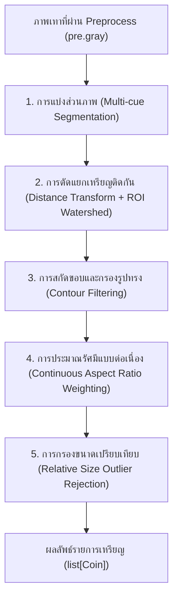

# บทที่ 2 การตรวจหาตำแหน่งเหรียญ (ส่วนที่ 2)

> ร่างบทรายงานของส่วนที่ 2: การตรวจหาตำแหน่งและขอบเขตเหรียญ (Detection)
> ไฟล์อ้างอิง: `backend/modules/detection/`, `eval/detection_baselines.py`, `eval/results/detection_baselines_tune.*`

---

## 2.1 ภาพรวมสถาปัตยกรรม (Architecture Overview)

เป้าหมายของส่วนที่ 2 คือการระบุตำแหน่งศูนย์กลาง $(c_x, c_y)$ รัศมีโดยประมาณ ($r$) และพารามิเตอร์วงรี (Major/Minor axes, Angle) ของเหรียญทุกเหรียญในภาพถ่าย เพื่อส่งต่อให้ส่วนที่ 3 นำไปจำแนกชนิดเหรียญและคำนวณยอดเงิน



กระบวนการตรวจหาเหรียญทำงานตามลำดับ 5 ขั้นตอนหลัก ดังนี้:

### 1. การแบ่งส่วนภาพ (Multi-cue Segmentation)
อินพุตเป็นภาพเทาขนาดด้านยาวไม่เกิน 1600 พิกเซล (`pre.gray`) ที่ผ่านการลดจุดรบกวนด้วย Median Filter:
- **Otsu Thresholding:** คำนวณขีดแบ่งสว่าง/มืดแบบอัตโนมัติจากฮิสโทแกรมทั้งภาพ เพื่อแยกเหรียญออกจากพื้นหลัง
- **Morphological Closing:** ทำการปิดช่องว่าง (Dilation ตามด้วย Erosion) ด้วย Kernel วงกลมขนาด $5 \times 5$ พิกเซล เพื่อเชื่อมออบเจกต์ที่อาจมีรอยต่อขาดหาย
- **Fill Internal Holes:** เติมเต็มช่องว่างหรือรูแสงสะท้อน (Specular Highlight) ภายในเหรียญ เพื่อไม่ให้บริเวณศูนย์กลางของเหรียญถูกเข้าใจผิดว่าเป็นพื้นหลัง

### 2. การตัดแยกกลุ่มเหรียญที่สัมผัสกัน (Touching Coins Separation)
เมื่อเหรียญวางชิดกัน ขอบเขตไบนารีจะรวมเป็นก้อนเดียว ระบบจึงใช้ Watershed Transform:
- คำนวณ **Euclidean Distance Transform ($L_2$)** บนหน้ากากไบนารี เพื่อหาระยะห่างจากทุกพิกเซลไปยังขอบที่ใกล้ที่สุด
- หา Local Peak ของระยะทางเพื่อใช้เป็น **Seed Markers** จุดศูนย์กลางของแต่ละเหรียญ
- ทำ **Morphological Dilation** และกำหนดพื้นที่ที่ไม่ใช่เหรียญเป็นฉลากพื้นหลัง (Background Marker = 1)
- รันอัลกอริทึม **Watershed** ขยายขอบเขตจาก Marker แต่ละจุดจนกระทั่งชนกันที่แนวน้ำท่วม (Watershed Ridge Lines)

### 3. การสกัด Contour และกรองคุณลักษณะรูปทรง (Shape Filtering)
สำหรับแต่ละ Marker ในภาพผลลัพธ์:
- หาเส้นรอบรูปภายนอก (Contour)
- ตรวจสอบพื้นที่ (Area): ต้องมีขนาดอย่างน้อย $\text{min\_area\_px} = 250.0 \text{ px}$ เพื่อกรองเศษจุดรบกวน
- ตรวจสอบความกลม (Circularity):
  $$\text{Circularity} = \frac{4 \pi \cdot \text{Area}}{\text{Perimeter}^2} \ge 0.65$$
  (สี่เหลี่ยมจัตุรัสมีค่า $\frac{\pi}{4} \approx 0.785$ แต่วัตถุที่มีเหลี่ยมมุมขรุขระหรือเส้นด้ายจะตกเกณฑ์นี้)

### 4. การ Fit วงรีและประมาณรัศมีแบบต่อเนื่อง (Continuous Ellipse Fitting)
ใช้ `cv2.fitEllipse` บนจุด Contour เพื่อรองรับทั้งภาพถ่ายมุมตรงและมุมเอียง (รายละเอียดในหัวข้อ 2.2)

### 5. การกรองขนาดสัมพัทธ์ (Relative Size Outlier Rejection)
เปรียบเทียบขนาดรัศมีของเหรียญทั้งหมดในภาพเดียวกัน เหรียญไทยที่มีขนาดเล็กที่สุด (25 สตางค์: 16.0 มม.) และใหญ่ที่สุด (10 บาท: 25.6 มม.) มีอัตราส่วนขนาดสูงสุดอยู่ที่:
$$\frac{25.6}{16.0} = 1.60$$
หากวัตถุใดมีรัศมีแตกต่างจากมัธยฐานของกลุ่มเหรียญในภาพเดียวกันเกินช่วง $0.35 \times r_{\text{median}}$ ถึง $2.20 \times r_{\text{median}}$ วัตถุนั้นจะถูกตัดทิ้งเป็น Outlier เพื่อป้องกันสิ่งแปลกปลอม

---

## 2.2 ปัญหาสำคัญและแนวทางแก้ไข (Key Challenges & Solutions)

### 1. ปัญหาความเร็วในการประมวลผล (Performance Optimization)
จากการตรวจวัดเวลาบน Render Free Tier (CPU 0.1 vCPU, RAM 512MB) ของส่วนที่ 4 พบว่าขั้นตอน Detection ใช้เวลาสูงถึง $4.4\text{ s}$ จากเวลารวม $5.4\text{ s}$ (คิดเป็น **81%** ของเวลาระบบ)

ทีมส่วนที่ 2 จึงได้ทำการวิเคราะห์โปรไฟล์โค้ดและปรับปรุงความเร็ว 3 จุดสำคัญ (PR #41):
1. **Vectorized Watershed Map (`render_watershed_map`):**
   - *เดิม:* วนลูป Python สแกนภาพขนาด 2 ล้านพิกเซลซ้ำตามจำนวนเหรียญ (`vis[markers == lbl] = color`)
   - *ใหม่:* ใช้ **NumPy Direct Look-Up Table (LUT) Indexing**:
     ```python
     vis = lut[np.maximum(0, markers)]
     ```
   - *ผลลัพธ์:* ลดเวลาสร้างภาพ Watershed Map จาก **~854 ms เหลือเพียง 26 ms** (เร็วกว่าเดิม 32 เท่า)
2. **Cropped ROI Watershed (`apply_watershed`):**
   - *เดิม:* นำภาพขนาดเต็มทั้งภาพ (1600 px) เข้าฟังก์ชัน `cv2.watershed`
   - *ใหม่:* ตัดเฉพาะพื้นที่กรอบล้อมรอบ (Bounding Box ROI) พร้อม Margin $10\text{ px}$ ของกลุ่มเหรียญที่สัมผัสกันมารัน Watershed
   - *ผลลัพธ์:* เร่งความเร็วขั้นตอน Watershed ขึ้น **2.15 เท่า** (ลดเวลาจาก 413 ms เหลือ 192 ms)
3. **Lazy Evaluation ของ Canny Edges:**
   - ย้ายการคำนวณ `cv2.Canny` ให้อยู่ภายใต้เงื่อนไข `pre.debug_images is not None` เพื่อไม่ให้เสียเวลาประมวลผลเมื่อผู้ใช้ไม่ได้เรียกดูภาพกลางทาง

> **ผลรวมด้านความเร็ว:** เวลาประมวลผลเฉลี่ยของ Detection ต่อภาพลดลงจาก **642 ms เหลือ 409 ms (−36%)** ในเครื่องพัฒนา และบน Render คาดการณ์ว่าเวลาจะลดลงจาก ~4.3s เหลือ ~2.8s

---

### 2. ปัญหารอยต่อความคลาดเคลื่อนรัศมี (Continuous Radius Weighting)
เมื่อเหรียญทรงกลมรัศมี $R$ ถูกบันทึกภาพในมุมมองเอียงทำมุม $\theta$:
- แกนยาว (Semi-major Axis: $M/2$) จะยังคงขนานกับระนาบมุมมอง จึงไม่เกิดการหดสั้น: $\frac{M}{2} = R$
- แกนสั้น (Semi-minor Axis: $m/2$) จะถูกบีบอัดตามมุมมอง: $\frac{m}{2} = R \cos\theta$
- อัตราส่วนแกนสั้นต่อแกนยาว (Aspect Ratio): $\alpha = \frac{m}{M} = \cos\theta$

ในโค้ดเดิม มีการแบ่งเงื่อนไขแบบขั้นบันได (Step Discontinuity):
- ถ้า $\alpha \ge 0.88$ ใช้รัศมีเฉลี่ยกึ่งแกน $\frac{M + m}{4}$
- ถ้า $\alpha < 0.88$ ใช้รัศมีแกนยาว $\frac{M}{2}$

**ปัญหาที่พบ:** ที่จุดตัด $\alpha = 0.88$ ค่าประมาณรัศมีจะเกิดการกระโดดกะทันหันถึง **~6%**:
$$\frac{M/2}{(M + 0.88M)/4} = \frac{0.50M}{0.47M} \approx 1.064$$
เนื่องจากส่วนต่างขนาดเส้นผ่านศูนย์กลางระหว่างเหรียญ 1 บาท (20.0 มม.) และเหรียญ 2 บาท (21.75 มม.) มีระยะห่างเพียง $8.75\%$ การกระโดด 6% จากสูตรจึงทำให้โมเดลจำแนกชนิดเหรียญผิดพลาด

**แนวทางแก้ไข:** ปรับใช้การถ่วงน้ำหนักแบบต่อเนื่อง (Continuous Smooth Blending) ในช่วง $\alpha \in [0.85, 0.95]$:
$$w = \text{clamp}\left(\frac{\alpha - 0.85}{0.95 - 0.85}, 0.0, 1.0\right)$$
$$r = w \cdot \frac{M + m}{4} + (1 - w) \cdot \frac{M}{2}$$

- เมื่อ $\alpha \ge 0.95$ (ถ่ายมุมตรง/เกือบตรง): ใช้น้ำหนัก $(M+m)/4$ เพื่อเฉลี่ย Noise ขอบหยักและเงา
- เมื่อ $\alpha \le 0.85$ (ถ่ายมุมเอียงชัดเจน): ใช้น้ำหนัก $M/2$ ซึ่งเป็นแกนที่ไม่ถูกบีบอัด
- ช่วง $0.85 - 0.95$: เชื่อมโยงกันอย่างเรียบเนียน ไร้รอยต่อกระโดด

---

### 3. ปัญหา False Positive บนพื้นผิวผ้าลาย (Textured Backgrounds)
ผ้าปูโต๊ะหรือผ้าลายทอที่มีลวดลายละเอียด มักทำให้เกิดจุดตรวจจับปลอม (False Positives) จำนวนมาก (ในชุด tune เดิมพบถึง 254 ตำแหน่ง)

**แนวทางแก้ไข:**
1. ปรับเกณฑ์ $\text{min\_circularity}$ จาก 0.60 เป็น 0.65 เพื่อตัดเส้นใยที่มีรูปร่างบิดเบี้ยว
2. กำหนด $\text{min\_area\_px} = 250.0\text{ px}$ (จากการทดลองพบว่าเหรียญ 25 สตางค์ในภาพขนาด 1600 px มีพื้นที่ $\ge 300\text{ px}$ อยู่แล้ว การใช้เกณฑ์ 250 px ช่วยตัดเศษผ้าทอได้ดีที่สุด)
3. ตกลงร่วมกับส่วนที่ 1 ปรับเปลี่ยนค่าเริ่มต้น `enhance` จาก `clahe` เป็น `none` (การไม่ใช้ CLAHE ช่วยลดการขยายสัญญาณรบกวนของเส้นใยผ้า ทำให้ False Positive ลดลงอย่างมีนัยสำคัญ)

---

## 2.3 ผลการทดลองเปรียบเทียบกับวิธีพื้นฐาน (Baseline Comparison)

ระบบได้เปรียบเทียบอัลกอริทึมที่นำเสนอ (Proposed Method) กับวิธีพื้นฐาน 3 รูปแบบ (`eval/detection_baselines.py`):
- **Proposed (Multi-cue + ROI Watershed + Continuous Ellipse):** วิธีการหลักของระบบ
- **Baseline A (No Watershed):** ตัดขั้นตอน Watershed ออก ใช้เพียง Otsu Thresholding และ Connected Components
- **Baseline B (K-Means Clustering):** แบ่งกลุ่มความสว่างพิกเซลด้วย K-Means ($K=2$) แทนการใช้ Otsu
- **Baseline C (Hough Circles):** ใช้อัลกอริทึม Hough Transform มาตรฐาน (`cv2.HoughCircles`)

### ผลการประเมินบนชุด Tune (84 ภาพ, 479 เหรียญจริง)
*(ชุด Tune ใช้สำหรับปรับจูนและตัดสินใจเลือกอัลกอริทึม)*

| วิธีการ (Method) | Precision | Recall | F1-Score | Mean Radius Error |
|---|:---:|:---:|:---:|:---:|
| **Proposed (Multi-cue + Watershed)** | **59.3%** | **62.6%** | **60.9%** | **8.62%** |
| Baseline A: No Watershed | 43.0% | 19.8% | 27.1% | 11.13% |
| Baseline B: K-Means | 43.4% | 19.8% | 27.2% | 11.71% |
| Baseline C: Hough Circles | 25.3% | 84.8% | 39.0% | 10.39% |

*จำนวนที่ใช้คิด (TP / FP / GT):*
- **Proposed:** 300 / 206 / 479
- **Baseline A:** 95 / 126 / 479
- **Baseline B:** 95 / 124 / 479
- **Baseline C:** 406 / 1198 / 479

### ผลการประเมินบนชุด Test (43 ภาพ, 212 เหรียญจริง)
*(ชุด Test ล็อกไว้หลัง PR #33 เพื่อวัดผลสรุปสุดท้าย รันครั้งเดียวโดยไม่มีการปรับแต่งค่าตามชุดทดสอบ)*

| วิธีการ (Method) | Precision | Recall | F1-Score | Mean Radius Error |
|---|:---:|:---:|:---:|:---:|
| **Proposed (Multi-cue + Watershed)** | **67.2%** | **59.0%** | **62.8%** | **8.40%** |
| Baseline A: No Watershed | 31.2% | 7.1% | 11.5% | 14.86% |
| Baseline B: K-Means | 31.2% | 7.1% | 11.5% | 15.18% |
| Baseline C: Hough Circles | 55.2% | 92.5% | 69.1% | 9.54% |

*จำนวนที่ใช้คิด (TP / FP / GT):*
- **Proposed:** 125 / 61 / 212
- **Baseline A:** 15 / 33 / 212
- **Baseline B:** 15 / 33 / 212
- **Baseline C:** 196 / 159 / 212

### การวิเคราะห์ผลการทดลอง:
1. **บทบาทสำคัญของ Watershed Transform:**
   เมื่อไม่มี Watershed (Baseline A และ B) ค่า Recall บนชุด Test ลดลงเหลือเพียง **7.1%** (หาเจอเพียง 15 จาก 212 เหรียญ) เนื่องจากเหรียญที่วางสัมผัสกันจะรวมตัวเป็นกลุ่มก้อนขนาดใหญ่ก้อนเดียว และตกเกณฑ์ความกลม (Circularity Rejection) Watershed จึงเป็นหัวใจสำคัญที่ทำให้ระบบสามารถตัดแยกเหรียญติดกันได้อย่างแท้จริง
2. **ข้อจำกัดของ Hough Circles:**
   แม้ Hough Circles จะได้ Recall สูง (92.5%) แต่มี False Positive สูงถึง 159 ตำแหน่ง และความคลาดเคลื่อนรัศมีสูงถึง 9.54% เนื่องจากอัลกอริทึมมักจับขอบซ้อนทับและเงาข้างเหรียญ
3. **ความแม่นยำของขนาดรัศมี:**
   Proposed Method ให้ความคลาดเคลื่อนรัศมีต่ำที่สุดทั้งสองชุดข้อมูล โดยบนชุด Test ได้ต่ำถึง **8.40%** เหนือกว่าทุกวิธีพื้นฐาน (9.54% – 15.18%) ซึ่งส่งผลต่อความแม่นยำในการคำนวณสเกลของส่วนที่ 3 โดยตรง
4. **ความแม่นยำของ Precision บนชุด Test:**
   โมเดล Proposed ได้ Precision บนชุด Test สูงถึง **67.2%** (เกิด False Positive เพียง 61 ตำแหน่ง) และ F1-Score สูงสุดที่ **62.8%** ยืนยันว่าโมเดลไม่เกิดการ Overfitting กับชุด Tune

---

## 2.4 การโต้ตอบและการทำงานร่วมกับส่วนอื่น (Interactive Correction & Integration)

### 1. ฟังก์ชันคลิกเพิ่มเหรียญโดยผู้ใช้ (`detect_coin_at`)
ในกรณีที่ระบบตรวจจับเหรียญตกหล่น ผู้ใช้สามารถแตะหน้าจอบนเว็บแอป ณ ตำแหน่งเหรียญเพื่อเพิ่มเหรียญได้:
- ระบบตัดภาพขนาดเล็กเฉพาะบริเวณรอบจุดคลิก (Local ROI ขนาด $140 \times 140$ พิกเซล)
- ดำเนินการ Thresholding และ Fit Ellipse ภายใน ROI เฉพาะจุด
- ใช้สูตรคำนวณรัศมีแบบถ่วงน้ำหนักต่อเนื่องชุดเดียวกัน เพื่อให้ขนาดเหรียญที่ผู้ใช้คลิกมีความสอดคล้องกับเหรียญอื่นในระบบ

### 2. อินเทอร์เฟซส่งต่อข้อมูล (`Coin` Schema)
ข้อมูลผลลัพธ์ของแต่ละเหรียญถูกบรรจุลงในอ็อบเจกต์ `Coin` ตามสัญญาข้อตกลงกลาง (`schemas/coin.py`):
```python
Coin(
    coin_id=0,
    center_xy=(cx, cy),       # ตำแหน่งพิกเซลบนภาพที่ย่อแล้ว
    radius_px=radius_px,     # รัศมีโดยประมาณ (พิกเซล)
    ellipse=(major, minor, angle), # พารามิเตอร์วงรีสำหรับวิเคราะห์มุมเอียง
    source="estimated",      # แหล่งที่มา ('estimated' หรือ 'user_added')
    status="ok",
)
```
ข้อมูลนี้จะถูกส่งต่อไปยังโมดูลจำแนกสีและสเกลในส่วนที่ 3 อย่างไร้รอยต่อ
